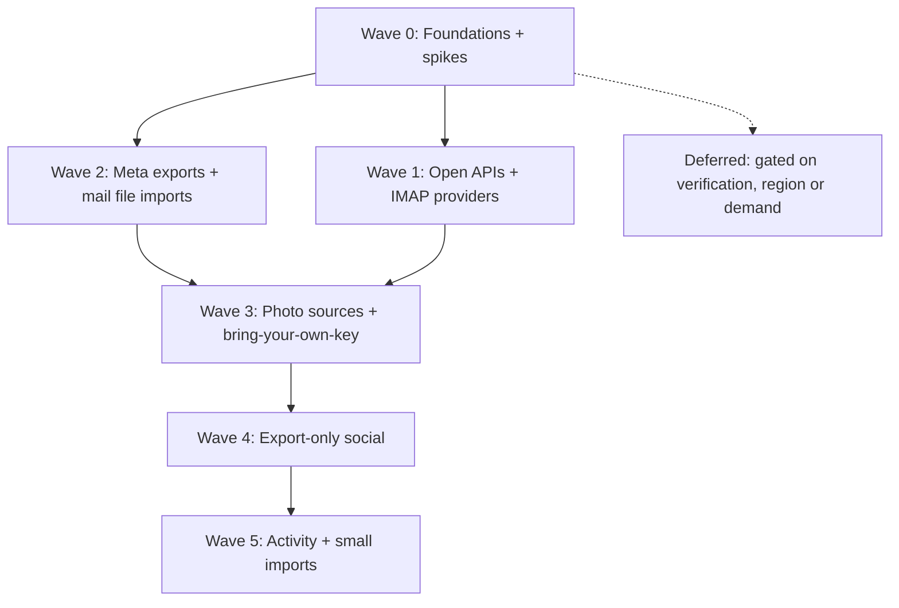

# Release plan: social and email sources

The order we build the social and email plans in, what each wave depends on, and a checklist
per wave. [ROADMAP.md](ROADMAP.md) stays the status table (one row per feature). This file is
the **sequence**. Each plan in [`plans/`](plans/) holds the detail.

**How to keep it current:** tick a box when that item's "Done when" is met (and update the plan's
frontmatter and roadmap row in the same change). Move an item to another wave when a spike or a
dependency changes, and say why in one line. Don't start a wave's items until its **Depends on**
items are ticked, unless an item says it can go early.

## Overview

| Wave | Social | Email | Social release no.* |
|---|---|---|---|
| 0 | Shared social foundation, setup panel, spikes | IMAP engine | — |
| 1 | Bluesky, Mastodon | Yahoo (migrate), AOL, iCloud, Fastmail, Yandex, GMX, Zoho, Outlook, Gmail over IMAP | 1 |
| 2 | Facebook, Instagram, Threads | MBOX/EML file imports (Takeout, Apple Mail, Thunderbird), Proton, Tuta | 2 |
| 3 | Snapchat Memories, Flickr, YouTube, X | — | 3–4 |
| 4 | Reddit, Pinterest, Tumblr, LinkedIn, TikTok | — | 5 |
| 5 | Strava, Goodreads / Letterboxd / Medium / Substack | — | 6 |

\* The release numbers recorded in the roadmap for the later social plans. Facebook, Instagram,
X, LinkedIn and TikTok are placed by dependency: X shares Flickr's OAuth 1.0a signer, and
LinkedIn and TikTok wait on their spikes.

---

## Wave 0: Foundations and spikes

Nothing user-visible ships alone here, except the IMAP engine, which keeps Yahoo and Outlook
working. Everything later builds on it. The spikes run **in parallel** with the build work,
because their answers decide the scope of Waves 2–4.

**Depends on:** nothing.

### Shared social foundation

Defined in [social-x-sync.md](plans/social-x-sync.md), *Shared social foundation*:
- [ ] **ADR 0002**: the social schema: `social_posts`, `social_posts_embeddings`,
      `imported_exports`, `social_sync_state`; `files.social_post_id` + `position`;
      `PhotoSource.socialPostId`
- [ ] Schema DDL + hand-written models (`AppDatabase.schemaDDL`, `models/tables/`)
- [ ] Add the **`archive`** (zip) and **`csv`** packages
      ([social-linkedin-archive.md](plans/social-linkedin-archive.md) §Parsing)
- [ ] **`ScannerManager` periodic trigger** (`Timer.periodic` per collection, configurable)
      ([social-facebook-sync.md](plans/social-facebook-sync.md))
- [ ] **Shared setup panel** (`ExportSetupPanel`, the generalised `MetaExportSetupPanel`):
      numbered steps, an open-settings button, a file picker with validation, import progress,
      sync status ([social-facebook-sync.md](plans/social-facebook-sync.md) §Setup and import UI)
- [ ] **Downloads watcher** (offers to import a known export zip that lands in `~/Downloads`)
- [ ] **`SocialPostCard`** + paged feed list (month headers, year jump bar, "On this day")
- [ ] **Search integration:** `SearchResultType.social`, `type:social` + per-platform aliases,
      FTS5 over `social_posts`, a vector retriever, `HybridRanker`, `NearResolver` over
      `social_posts`, `social` as an LLM `search` source (ADR 0001)
- [ ] **Text-row embedding isolate** (generalise `EmailEmbeddingIsolate` to take a table)

### Email foundation

- [ ] **IMAP engine** ([email-imap-engine.md](plans/email-imap-engine.md)):
  - [ ] provider registry;
  - [ ] one `ImapScanner` merged from the Yahoo and Outlook isolates;
  - [ ] UID / `UIDVALIDITY` / CONDSTORE incremental sync;
  - [ ] SPECIAL-USE folder mapping;
  - [ ] Message-ID dedupe;
  - [ ] the delete-policy setting;
  - [ ] one setup flow with autodetect, plus "Other (IMAP)";
  - [ ] a Docker IMAP test server.

### Spikes (real accounts; record the answers in each plan)

- [ ] **Meta scheduled export** (Facebook, Instagram, Threads): does the EYI deep link work for
      us? Do scheduled Drive transfers carry full JSON, or media only? Is a relative
      `date_range` re-evaluated on each run? Drive folder names? Is Threads its own
      `account_type`? → gates Wave 2's *scheduled* sync (the one-time import doesn't wait)
- [ ] **TikTok:** do the export's video links download? → gates TikTok in Wave 4
- [ ] **LinkedIn:** the real `Shares.csv` columns, date format, media-link lifetime → gates
      LinkedIn in Wave 4
- [ ] **Snapchat:** does the Memories download link need a POST? Expiry? Overlays? → gates
      Wave 3
- [ ] **YouTube Takeout:** are titles and descriptions in the metadata? Can it be scheduled to
      Drive? → gates Wave 3
- [ ] **X:** the billed rate for full-archive search; OAuth 1.0a still accepted for v2 reads;
      live field names → gates Wave 3
- [ ] **Gmail:** are app passwords still offered? Is there a CASA exemption for an on-device
      app? → decides Wave 1's Gmail path and the deferred Gmail API

---

## Wave 1: Open APIs and IMAP providers

Real ongoing sync for the most people, with no platform approval needed.

**Depends on:** Wave 0 shared social foundation (for Bluesky and Mastodon); the IMAP engine
(for email). The Gmail spike decides Gmail's path.

### Social
- [ ] **Bluesky** ([social-bluesky-sync.md](plans/social-bluesky-sync.md)):
      handle → DID → PDS, app-password sign-in, `listRecords` backfill, blobs, incremental
- [ ] **Mastodon** ([social-mastodon-sync.md](plans/social-mastodon-sync.md)):
      per-server OAuth (runtime app registration), backfill, edits, media, archive-zip import

### Email (registry entries + setup text on the engine)
- [ ] **Yahoo**: migrate existing collections without re-download; add **AT&T**
      ([email-yahoo.md](plans/email-yahoo.md))
- [ ] **Outlook / Microsoft 365**: our own Entra app (public PKCE client, no secret), publisher
      verification, M365 error guidance ([email-outlook.md](plans/email-outlook.md))
- [ ] **Gmail over IMAP + app password**: `[Gmail]/All Mail`, `X-GM-LABELS`, `X-GM-MSGID`,
      daily-limit throttling ([email-gmail.md](plans/email-gmail.md) §B)
- [ ] **AOL + Verizon.net** ([email-aol.md](plans/email-aol.md))
- [ ] **iCloud** ([email-icloud.md](plans/email-icloud.md))
- [ ] **Fastmail** ([email-fastmail.md](plans/email-fastmail.md))
- [ ] **Yandex** ([email-yandex.md](plans/email-yandex.md))
- [ ] **GMX / mail.com / WEB.DE** ([email-gmx.md](plans/email-gmx.md))
- [ ] **Zoho** (per-region hosts; free-plan handling) ([email-zoho.md](plans/email-zoho.md))

---

## Wave 2: Meta exports and mail file imports

The biggest social audiences, plus every mailbox that can't be synced over IMAP.

**Depends on:** Wave 0 (setup panel, `archive`, `imported_exports`, schema). **Scheduled**
Meta sync also depends on the Meta spike. One-time imports can ship first.

### Social: Meta
- [ ] **Shared Meta pieces:** `meta_export_text.dart` (mojibake fix), the export identity hash,
      the **Drive handoff** (`google_file_scanner.dart` recognises Meta export zips), and the
      **schedule lifecycle** (renew and stale warnings)
- [ ] **Facebook**: one-time import first, then the scheduled daily export to Drive
      ([social-facebook-sync.md](plans/social-facebook-sync.md))
- [ ] **Instagram**: the same, plus the grid UI and stories strip
      ([social-instagram-sync.md](plans/social-instagram-sync.md))
- [ ] **Threads**: export import, scheduled if the spike allows
      ([social-threads-sync.md](plans/social-threads-sync.md))

### Email: files
- [ ] **MBOX / EML importer**: streaming MBOX, EML folders, `X-Gmail-Labels`, dedupe with IMAP
      collections ([email-file-imports.md](plans/email-file-imports.md))
- [ ] **Gmail Takeout** steps on the import card ([email-gmail.md](plans/email-gmail.md) §C)
- [ ] **Proton**: Bridge registry entry (STARTTLS, pinned localhost cert, "Bridge not running"
      handling), plus the free-plan export path ([email-proton.md](plans/email-proton.md))
- [ ] **Tuta**: export steps and EML import ([email-file-imports.md](plans/email-file-imports.md))

---

## Wave 3: Photo sources and bring-your-own-key

High value for the Photos module and the map, plus the paid X sync.

**Depends on:** Wave 2's Drive handoff (YouTube Takeout to Drive); Wave 0's setup panel;
the Snapchat, YouTube and X spikes.

- [ ] **OAuth 1.0a signer** (shared by Flickr and X), with tests against the documented
      examples
- [ ] **Camera-roll dedupe** (perceptual hash or embedding match → `files.duplicate_of`; link,
      don't delete). Shared by Snapchat, Instagram and Flickr. Can slip to Wave 4 if needed
- [ ] **Snapchat Memories** ([social-snapchat-memories.md](plans/social-snapchat-memories.md))
- [ ] **Flickr**: bring-your-own API key sync, plus data-export import
      ([social-flickr-archive.md](plans/social-flickr-archive.md))
- [ ] **YouTube** via Takeout, with size controls
      ([social-youtube-archive.md](plans/social-youtube-archive.md))
- [ ] **X**: bring-your-own keys, cost estimate, timeline + optional full-archive search, X
      archive import ([social-x-sync.md](plans/social-x-sync.md))

---

## Wave 4: Export-only social

Simple imports, each with a re-export reminder, since none of these can be scheduled.

**Depends on:** Wave 0 (`csv`, setup panel); the LinkedIn and TikTok spikes for those two.

- [ ] **Reddit**: posts, comments opt-in ([social-reddit-archive.md](plans/social-reddit-archive.md))
- [ ] **Pinterest**: boards → albums ([social-pinterest-archive.md](plans/social-pinterest-archive.md))
- [ ] **Tumblr**: per-blog exports ([social-tumblr-archive.md](plans/social-tumblr-archive.md))
- [ ] **LinkedIn**: `Shares.csv` + articles ([social-linkedin-archive.md](plans/social-linkedin-archive.md))
- [ ] **TikTok**: export import (videos only if the spike confirms the links work)
      ([social-tiktok-archive.md](plans/social-tiktok-archive.md))

---

## Wave 5: Activity and small imports

**Depends on:** Wave 0; the Articles list from LinkedIn (Wave 4) for Medium and Substack.

- [ ] **Strava**: `activities.csv`, GPX/TCX in Dart, a FIT endpoint in aiserver,
      `activity_tracks`, a routes map layer, route-aware `near:`
      ([social-strava-archive.md](plans/social-strava-archive.md))
- [ ] **Goodreads, Letterboxd, Medium, Substack**
      ([social-csv-exports.md](plans/social-csv-exports.md))

---

## Deferred (gated)

Built only when the gate opens, and only if users need what the shipped path can't give.

| Item | Gate | Plan |
|---|---|---|
| Facebook Graph API sync, plus the Cloud Run token service | xdtlabs **business verification** + Meta App Review | [social-facebook-sync.md](plans/social-facebook-sync.md) §Deferred |
| Instagram API (professional accounts) | Same Meta app + App Review; real user need | [social-instagram-sync.md](plans/social-instagram-sync.md) §Deferred |
| Threads API | Same Meta app + App Review | [social-threads-sync.md](plans/social-threads-sync.md) §Path 2 |
| Gmail API as the shipped path | Google OAuth verification + yearly CASA budget | [email-gmail.md](plans/email-gmail.md) §A |
| Microsoft Graph mail for IMAP-disabled M365 tenants | Users asking | [email-outlook.md](plans/email-outlook.md) |
| TikTok Data Portability API | EEA/UK users only; TikTok approval | [social-tiktok-archive.md](plans/social-tiktok-archive.md) §Path 2 |
| LinkedIn portability APIs | EEA/Swiss only (ignored for now) | [social-linkedin-archive.md](plans/social-linkedin-archive.md) |
| Reddit, Tumblr and Strava API phases | After their export imports ship | Each plan's *Path 2* |
| YouTube Data API | Need for faster metadata | [social-youtube-archive.md](plans/social-youtube-archive.md) |
| Fastmail JMAP | IMAP proving slow | [email-fastmail.md](plans/email-fastmail.md) |
| IMAP `IDLE` push | After 15-minute polling is stable | [email-imap-engine.md](plans/email-imap-engine.md) |
