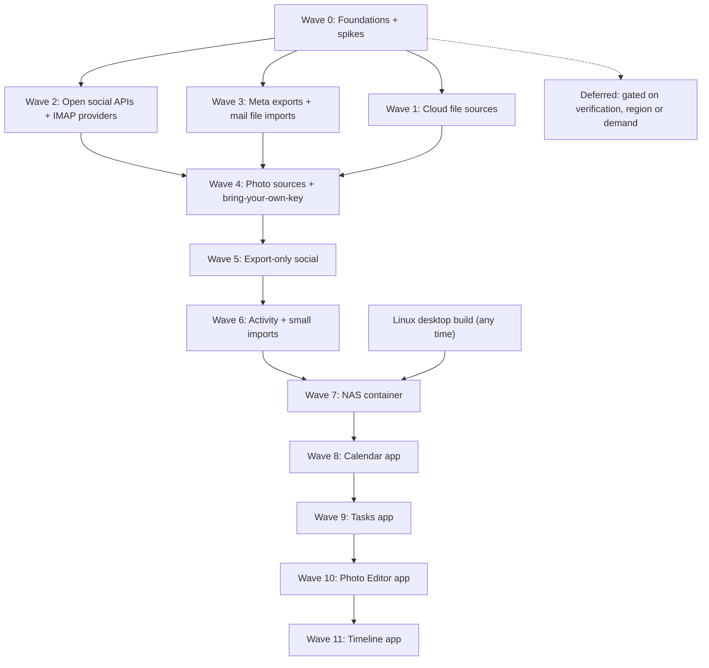

# Release plan: social, email and file sources

The order we build the social, email and file-storage plans in, what each wave depends on, and a checklist
per wave. [ROADMAP.md](ROADMAP.md) stays the status table (one row per feature). This file is
the **sequence**. Each plan in [`plans/`](plans/) holds the detail.

**How to keep it current:** tick a box when that item's "Done when" is met (and update the plan's
frontmatter and roadmap row in the same change). Move an item to another wave when a spike or a
dependency changes, and say why in one line. Don't start a wave's items until its **Depends on**
items are ticked, unless an item says it can go early.

## Overview

| Wave | Social | Email | Files | Social release no.* |
|---|---|---|---|---|
| 0 | Shared social foundation, setup panel, spikes | IMAP engine | `CloudFileScanner`, change cursors, sync-folder connector, dataless detection | — |
| 1 | — | — | Sync folders (iCloud Drive, Dropbox, OneDrive, Google Drive, Box Drive, pCloud Drive, Proton Drive, MEGA, Sync.com); Dropbox, OneDrive and Box APIs; Google Drive Changes API | — |
| 2 | Bluesky, Mastodon | Yahoo (migrate), AOL, iCloud, Fastmail, Yandex, GMX, Zoho, Outlook, Gmail over IMAP | — | 1 |
| 3 | Facebook, Instagram, Threads | MBOX/EML file imports (Takeout, Apple Mail, Thunderbird), Proton, Tuta | — | 2 |
| 4 | Snapchat Memories, Flickr, YouTube, X | — | Google Photos via Takeout | 3–4 |
| 5 | Reddit, Pinterest, Tumblr, LinkedIn, TikTok | — | WebDAV/Nextcloud/NAS | 5 |
| 6 | Strava, Goodreads / Letterboxd / Medium / Substack | — | — | 6 |
| 7 | NAS container (the whole app on a Synology, in the browser) | — | NAS shares as read-only local mounts | — |
| 8–11 | Apps, after the collection work: Calendar, Tasks, Photo Editor, Timeline | — | — | — |

The **Windows** and **Linux desktop builds** in GitHub Actions
([core-ci-windows-build.md](plans/core-ci-windows-build.md),
[core-ci-linux-build.md](plans/core-ci-linux-build.md)) aren't tied to a wave. They can start at
any time, and doing them early keeps new source work from adding macOS-only assumptions. The
Linux build must be done before Wave 7.

\* The release numbers recorded in the roadmap for the later social plans. Facebook, Instagram,
X, LinkedIn and TikTok are placed by dependency: X shares Flickr's OAuth 1.0a signer, and
LinkedIn and TikTok wait on their spikes.

---

## Wave 0: Foundations and spikes

Nothing user-visible ships alone here, except the IMAP engine, which keeps Yahoo and Outlook
working. Everything later builds on it. The spikes run **in parallel** with the build work,
because their answers decide the scope of Waves 3–5.

**Depends on:** nothing.

### Shared social foundation

Defined in [social-x-sync.md](plans/social-x-sync.md), *Shared social foundation*:
- [ ] **ADR 0002**: the social schema: `social_posts`, `social_posts_embeddings`,
      `imported_exports`, `social_sync_state`; `files.social_post_id` + `position`;
      `PhotoSource.socialPostId`
- [ ] Schema DDL + hand-written models (`AppDatabase.schemaDDL`, `models/tables/`)
- [ ] Add the **`archive`** (zip) and **`csv`** packages
      ([social-linkedin-archive.md](plans/social-linkedin-archive.md) §Parsing)
- [ ] **`ScannerManager` periodic trigger** (`Timer.periodic` per collection, configurable)
      ([social-facebook-sync.md](plans/social-facebook-sync.md))
- [ ] **Shared setup panel** (`ExportSetupPanel`, the generalised `MetaExportSetupPanel`):
      numbered steps, an open-settings button, a file picker with validation, import progress,
      sync status ([social-facebook-sync.md](plans/social-facebook-sync.md) §Setup and import UI)
- [ ] **Downloads watcher** (offers to import a known export zip that lands in `~/Downloads`)
- [ ] **`SocialPostCard`** + paged feed list (month headers, year jump bar, "On this day")
- [ ] **Search integration:** `SearchResultType.social`, `type:social` + per-platform aliases,
      FTS5 over `social_posts`, a vector retriever, `HybridRanker`, `NearResolver` over
      `social_posts`, `social` as an LLM `search` source (ADR 0001)
- [ ] **Text-row embedding isolate** (generalise `EmailEmbeddingIsolate` to take a table)

### Email foundation

- [ ] **IMAP engine** ([email-imap-engine.md](plans/email-imap-engine.md)):
  - [ ] provider registry;
  - [ ] one `ImapScanner` merged from the Yahoo and Outlook isolates;
  - [ ] UID / `UIDVALIDITY` / CONDSTORE incremental sync;
  - [ ] SPECIAL-USE folder mapping;
  - [ ] Message-ID dedupe;
  - [ ] the delete-policy setting;
  - [ ] one setup flow with autodetect, plus "Other (IMAP)";
  - [ ] a Docker IMAP test server.

### File-source foundation

From [files-sources-foundation.md](plans/files-sources-foundation.md):
- [x] **`CloudFileScanner`** + `CloudFileApi` adapter interface (Google Drive moved onto it
      first, unchanged behaviour). Merged in #40.
- [x] **Change-cursor sync** with `file_source_sync_state`: moves and deletes, cursor-expiry
      re-list, the "keep deleted files" setting. Merged in #40; the cursor is stored in
      `collections.change_cursor` rather than a separate table.
- [x] **Content policy** (metadata always; thumbnails and photos; documents for text up to a
      limit; the estimate before the first sync). Merged in #40.
- [ ] **Sync-folder connector**: detect `~/Library/CloudStorage/*`, iCloud Drive and legacy
      folders; `providerHint`; **dataless (`SF_DATALESS`) detection via FFI `stat`**; legacy
      `.icloud` stubs; indexing online-only files. **Pending testing.** Detection,
      `SF_DATALESS` and `.icloud` stubs merged in #40 and #42. Online-only files are now
      indexed: each is read (which downloads it), then evicted again. Sync-folder cards offer
      "Save a local copy of" (all ticked by default), which copies files into the archive and
      evicts the ones that were online-only. Still to do: `providerHint`.
- [x] **OAuth:** relax `DesktopOAuthManager`'s "secret required" check per provider (PKCE
      public clients). Merged in #40.
- [x] **`files.content_hash`** + cross-source dedupe. Merged in #40; the EmbeddingGemma
      column fix is in #42.
- [x] **New file source page:** "Found on this Mac" / "Connect an account" / "Other". Merged in
      #40 as a searchable catalog with two groups, "Folders on this Mac" and "Cloud accounts";
      each tile opens its own form.

### Spikes (real accounts; record the answers in each plan)

- [ ] **Meta scheduled export** (Facebook, Instagram, Threads): does the EYI deep link work for
      us? Do scheduled Drive transfers carry full JSON, or media only? Is a relative
      `date_range` re-evaluated on each run? Drive folder names? Is Threads its own
      `account_type`? → gates Wave 3's *scheduled* sync (the one-time import doesn't wait)
- [ ] **TikTok:** do the export's video links download? → gates TikTok in Wave 5
- [ ] **LinkedIn:** the real `Shares.csv` columns, date format, media-link lifetime → gates
      LinkedIn in Wave 5
- [ ] **Snapchat:** does the Memories download link need a POST? Expiry? Overlays? → gates
      Wave 4
- [ ] **YouTube Takeout:** are titles and descriptions in the metadata? Can it be scheduled to
      Drive? → gates Wave 4
- [ ] **X:** the billed rate for full-archive search; OAuth 1.0a still accepted for v2 reads;
      live field names → gates Wave 4
- [ ] **Gmail:** are app passwords still offered? Is there a CASA exemption for an on-device
      app? → decides Wave 2's Gmail path and the deferred Gmail API
- [ ] **Google restricted scopes (Gmail + Drive together):** one verification and CASA
      assessment covering `gmail.readonly` and `drive.readonly`? Cost and timeline → decides
      Wave 1's Google Drive public-release path
- [ ] **Sync folders:** real folder names under `~/Library/CloudStorage/` for each provider app
      (Box Drive, Proton Drive, pCloud Drive, MEGA); whether our entitlements can read
      `~/Library/Mobile Documents` → gates Wave 1's sync-folder cards. **Open:** the cards were
      built ahead of the spike (#42) and match pCloud, Proton Drive and MEGA names by guess;
      confirming those three is deferred (lower priority). The app can read `Mobile Documents`
      on the dev Mac.
- [ ] **Box:** does token exchange require a client secret (→ token service)? →
      gates Wave 1's Box API (the pCloud API is deferred)

---

## Wave 1: Cloud file sources

The most popular cloud storage services, as sync folders and through their APIs.

**Depends on:** the Wave 0 file-source foundation, the sync-folder spike, and the Box spike
(for the Box API). Google Drive (Changes API) and the Box API moved up from Waves 3 and 5.

**Status:** the sync-folder cards and the Dropbox and OneDrive APIs are built in #42; the Google
Drive Changes API and the Box API are not started. Nothing is ticked until it is merged and checked
against real accounts or real sync-app folders.

- [ ] **Sync-folder cards** (no sign-in), one per detected app. **Pending testing:** each card
      still needs checking against a real sync-app folder.
  - [ ] **iCloud Drive** ([files-icloud-drive.md](plans/files-icloud-drive.md)). App
        containers are no longer listed: one "iCloud Drive" card is rooted at
        `com~apple~CloudDocs`, by product decision
  - [ ] **Dropbox** folder ([files-dropbox.md](plans/files-dropbox.md))
  - [ ] **OneDrive** folder ([files-onedrive.md](plans/files-onedrive.md))
  - [ ] **Google Drive** folder ([files-google-drive.md](plans/files-google-drive.md))
  - [ ] **Box Drive** folder ([files-box.md](plans/files-box.md))
  - Lower priority: these cards are built (#42), but further work on them is deferred,
    including confirming the pCloud, Proton Drive and MEGA folder names (guesses today):
    - [ ] **pCloud Drive** folder ([files-pcloud.md](plans/files-pcloud.md))
    - [ ] **Proton Drive** folder ([files-proton-drive.md](plans/files-proton-drive.md))
    - [ ] **MEGA** folder ([files-mega.md](plans/files-mega.md))
    - [ ] **Sync.com** folder ([files-sync-com.md](plans/files-sync-com.md))
- [ ] **Dropbox API**: PKCE app, `list_folder` cursor, batch thumbnails; **production approval
      before 50 linked users** ([files-dropbox.md](plans/files-dropbox.md)). Built: PKCE,
      cursor sync, cursor reset, 429 backoff, batch thumbnails. App registration and
      production approval still to do.
- [ ] **OneDrive API**: the Outlook Entra app plus `Files.Read`, Graph `delta`, personal and
      work accounts ([files-onedrive.md](plans/files-onedrive.md)). Built: `/common` PKCE sign-in,
      delta sync, 410 resync, thumbnails. Not tested: work accounts.
- [ ] **Google Drive:** move to the Changes API (deletes and moves), narrow to `drive.readonly`,
      export Google-native files for text, shared drives. The public-release path follows the
      restricted-scope spike; until then, the sync folder ([files-google-drive.md](plans/files-google-drive.md))
- [ ] **Box API**: Events API cursor; token service if a secret is required
      ([files-box.md](plans/files-box.md))

---

## Wave 2: Open social APIs and IMAP providers

Moved out of Wave 1 so the file sources ship first. Real ongoing sync for the most people, with
no platform approval needed.

**Depends on:** Wave 0 shared social foundation (for Bluesky and Mastodon); the IMAP engine
(for email). The Gmail spike decides Gmail's path.

### Social
- [ ] **Bluesky** ([social-bluesky-sync.md](plans/social-bluesky-sync.md)):
      handle → DID → PDS, app-password sign-in, `listRecords` backfill, blobs, incremental
- [ ] **Mastodon** ([social-mastodon-sync.md](plans/social-mastodon-sync.md)):
      per-server OAuth (runtime app registration), backfill, edits, media, archive-zip import

### Email (registry entries + setup text on the engine)
- [ ] **Yahoo**: migrate existing collections without re-download; add **AT&T**
      ([email-yahoo.md](plans/email-yahoo.md))
- [ ] **Outlook / Microsoft 365**: our own Entra app (public PKCE client, no secret), publisher
      verification, M365 error guidance ([email-outlook.md](plans/email-outlook.md))
- [ ] **Gmail over IMAP + app password**: `[Gmail]/All Mail`, `X-GM-LABELS`, `X-GM-MSGID`,
      daily-limit throttling ([email-gmail.md](plans/email-gmail.md) §B)
- [ ] **AOL + Verizon.net** ([email-aol.md](plans/email-aol.md))
- [ ] **iCloud** ([email-icloud.md](plans/email-icloud.md))
- [ ] **Fastmail** ([email-fastmail.md](plans/email-fastmail.md))
- [ ] **Yandex** ([email-yandex.md](plans/email-yandex.md))
- [ ] **GMX / mail.com / WEB.DE** ([email-gmx.md](plans/email-gmx.md))
- [ ] **Zoho** (per-region hosts; free-plan handling) ([email-zoho.md](plans/email-zoho.md))

---

## Wave 3: Meta exports and mail file imports

The biggest social audiences, plus every mailbox that can't be synced over IMAP.

**Depends on:** Wave 0 (setup panel, `archive`, `imported_exports`, schema). **Scheduled**
Meta sync also depends on the Meta spike. One-time imports can ship first.

### Social: Meta
- [ ] **Shared Meta pieces:** `meta_export_text.dart` (mojibake fix), the export identity hash,
      the **Drive handoff** (`google_file_scanner.dart` recognises Meta export zips), and the
      **schedule lifecycle** (renew and stale warnings)
- [ ] **Facebook**: one-time import first, then the scheduled daily export to Drive
      ([social-facebook-sync.md](plans/social-facebook-sync.md))
- [ ] **Instagram**: the same, plus the grid UI and stories strip
      ([social-instagram-sync.md](plans/social-instagram-sync.md))
- [ ] **Threads**: export import, scheduled if the spike allows
      ([social-threads-sync.md](plans/social-threads-sync.md))

### Email: files
- [ ] **MBOX / EML importer**: streaming MBOX, EML folders, `X-Gmail-Labels`, dedupe with IMAP
      collections ([email-file-imports.md](plans/email-file-imports.md))
- [ ] **Gmail Takeout** steps on the import card ([email-gmail.md](plans/email-gmail.md) §C)
- [ ] **Proton**: Bridge registry entry (STARTTLS, pinned localhost cert, "Bridge not running"
      handling), plus the free-plan export path ([email-proton.md](plans/email-proton.md))
- [ ] **Tuta**: export steps and EML import ([email-file-imports.md](plans/email-file-imports.md))

---

## Wave 4: Photo sources and bring-your-own-key

High value for the Photos module and the map, plus the paid X sync.

**Depends on:** Wave 3's Drive handoff (YouTube Takeout to Drive); Wave 0's setup panel;
the Snapchat, YouTube and X spikes.

- [ ] **OAuth 1.0a signer** (shared by Flickr and X), with tests against the documented
      examples
- [ ] **Camera-roll dedupe** (perceptual hash or embedding match → `files.duplicate_of`; link,
      don't delete). Shared by Snapchat, Instagram and Flickr. Can slip to Wave 5 if needed
- [ ] **Snapchat Memories** ([social-snapchat-memories.md](plans/social-snapchat-memories.md))
- [ ] **Flickr**: bring-your-own API key sync, plus data-export import
      ([social-flickr-archive.md](plans/social-flickr-archive.md))
- [ ] **YouTube** via Takeout, with size controls
      ([social-youtube-archive.md](plans/social-youtube-archive.md))
- [ ] **X**: bring-your-own keys, cost estimate, timeline + optional full-archive search, X
      archive import ([social-x-sync.md](plans/social-x-sync.md))
- [ ] **Google Photos via Takeout**: JSON sidecar merge (capture dates, geo), albums, scheduled
      Takeout to Drive, dedupe ([files-google-photos.md](plans/files-google-photos.md))

---

## Wave 5: Export-only social and WebDAV/NAS

Simple social imports, each with a re-export reminder since none can be scheduled, plus
WebDAV/NAS.

**Depends on:** Wave 0 (`csv`, setup panel, file-source foundation); the LinkedIn and TikTok
spikes for those two.

### Files
- [ ] **WebDAV / Nextcloud / Synology / NAS**: Nextcloud Login Flow v2, ETag walk, pinned
      self-signed certificates, offline volumes not treated as deleted (this also fixes external
      drives) ([files-webdav-nas.md](plans/files-webdav-nas.md))

### Social

- [ ] **Reddit**: posts, comments opt-in ([social-reddit-archive.md](plans/social-reddit-archive.md))
- [ ] **Pinterest**: boards → albums ([social-pinterest-archive.md](plans/social-pinterest-archive.md))
- [ ] **Tumblr**: per-blog exports ([social-tumblr-archive.md](plans/social-tumblr-archive.md))
- [ ] **LinkedIn**: `Shares.csv` + articles ([social-linkedin-archive.md](plans/social-linkedin-archive.md))
- [ ] **TikTok**: export import (videos only if the spike confirms the links work)
      ([social-tiktok-archive.md](plans/social-tiktok-archive.md))

---

## Wave 6: Activity and small imports

**Depends on:** Wave 0; the Articles list from LinkedIn (Wave 5) for Medium and Substack.

- [ ] **Strava**: `activities.csv`, GPX/TCX in Dart, a FIT endpoint in aiserver,
      `activity_tracks`, a routes map layer, route-aware `near:`
      ([social-strava-archive.md](plans/social-strava-archive.md))
- [ ] **Goodreads, Letterboxd, Medium, Substack**
      ([social-csv-exports.md](plans/social-csv-exports.md))

---

## Wave 7: NAS container

Near the end of feature development: the whole app, running 24/7 on a Synology NAS and used
from a browser.

**Depends on:** the Linux desktop build (including its `xvfb-run` smoke test, and the
`webview_flutter`/`pdfx` replacements); Waves 0–6 as far as they've shipped. Everything that
works in the Linux build works in the container.

- [ ] **Spike** on a real Synology: base-image choice (jlesage vs LinuxServer KasmVNC/Selkies);
      memory and CPU at idle, while scanning and while embedding; OAuth through the
      in-container browser; a 100k-file share scan
- [ ] **Image**: base + GTK3/Mesa/libmpv/fonts/zenity/Firefox ESR; `NAS_MODE` (maximised, no
      Quit); `/config` (local volume) and `/nas` (read-only share mounts)
- [ ] **Security**: web login + HTTPS from the base image; docs for Tailscale/VPN remote
      access; no port forwarding
- [ ] **AI workload**: a runtime **remote aiserver** setting (today `PYTHON_SERVER_URL` is a
      build-time dart-define), throttled CPU indexing, the documented minimum RAM
- [ ] **Synology excludes** (`@eaDir`, `#recycle`, `#snapshot`, `.SynologyWorkingDirectory`) in
      the scanner, plus read-only collections hiding Delete
- [ ] **CI**: multi-arch (amd64 + arm64) image to GHCR on tagged releases; a compose example and
      a Container Manager guide
- Plan: [core-nas-docker.md](plans/core-nas-docker.md)

---

## Waves 8–11: Apps

The built-in apps, built after the collection work in Waves 0–7. Each plan breaks its app into
phases with their own checklists; this section only fixes the order.

**Depends on:** the collection waves. Specific phases need specific sources:
- Calendar C6 (Outlook PST calendars) builds on Email's existing PST import.
- Timeline L4 (social posts) needs the Wave 0 social foundation and the social sources.
- Timeline L6 (GPS tracks) uses the `tracks` table that Strava creates in Wave 6.
- Timeline L7 (flights from email) needs synced email collections.
- Timeline's later calendar lane needs the Calendar app.

- [ ] **Wave 8: Calendar** ([app-calendar.md](plans/app-calendar.md)): first because it's a
      collection type of its own (Google, Microsoft Graph, CalDAV, `.ics` and file imports)
- [ ] **Wave 9: Tasks** ([app-tasks.md](plans/app-tasks.md)): no source dependencies; its
      `AccentPalette` is shared with Calendar
- [ ] **Wave 10: Photo Editor** ([app-photo-editor.md](plans/app-photo-editor.md))
- [ ] **Wave 11: Timeline** ([app-timeline.md](plans/app-timeline.md)): last because it reads
      from nearly every source (photos, social posts, tracks, flight emails, calendar). Replaces
      the Timeline view and trip playback dropped from the photos rewrite

---

## Deferred (gated)

Built only when the gate opens, and only if users need what the shipped path can't give.

| Item | Gate | Plan |
|---|---|---|
| Facebook Graph API sync, plus the Cloud Run token service | xdtlabs **business verification** + Meta App Review | [social-facebook-sync.md](plans/social-facebook-sync.md) §Deferred |
| Instagram API (professional accounts) | Same Meta app + App Review; real user need | [social-instagram-sync.md](plans/social-instagram-sync.md) §Deferred |
| Threads API | Same Meta app + App Review | [social-threads-sync.md](plans/social-threads-sync.md) §Path 2 |
| Gmail API as the shipped path | Google OAuth verification + yearly CASA budget | [email-gmail.md](plans/email-gmail.md) §A |
| Microsoft Graph mail for IMAP-disabled M365 tenants | Users asking | [email-outlook.md](plans/email-outlook.md) |
| TikTok Data Portability API | EEA/UK users only; TikTok approval | [social-tiktok-archive.md](plans/social-tiktok-archive.md) §Path 2 |
| LinkedIn portability APIs | EEA/Swiss only (ignored for now) | [social-linkedin-archive.md](plans/social-linkedin-archive.md) |
| Reddit, Tumblr and Strava API phases | After their export imports ship | Each plan's *Path 2* |
| YouTube Data API | Need for faster metadata | [social-youtube-archive.md](plans/social-youtube-archive.md) |
| Fastmail JMAP | IMAP proving slow | [email-fastmail.md](plans/email-fastmail.md) |
| IMAP `IDLE` push | After 15-minute polling is stable | [email-imap-engine.md](plans/email-imap-engine.md) |
| Google Drive API for public release | Google verification + CASA (shared with Gmail) | [files-google-drive.md](plans/files-google-drive.md) |
| SharePoint sites | Users asking; may need tenant admin consent | [files-onedrive.md](plans/files-onedrive.md) |
| Proton Drive SDK | Proton supporting third-party auth | [files-proton-drive.md](plans/files-proton-drive.md) |
| MEGAcmd for cloud-only MEGA content | Users asking; SDK licence check | [files-mega.md](plans/files-mega.md) |
| Dropbox long-poll / instant sync | After 30-minute polling is stable | [files-dropbox.md](plans/files-dropbox.md) |
| pCloud API | Lower priority; users asking | [files-pcloud.md](plans/files-pcloud.md) |
| Confirming the pCloud, Proton Drive and MEGA sync-folder names (cards built on guesses in #42) | Lower priority; users reporting a missed folder | [files-sources-foundation.md](plans/files-sources-foundation.md) |
| Amazon Photos / Amazon Drive | No public API (Drive API shut down) | [files-sources-foundation.md](plans/files-sources-foundation.md) |
