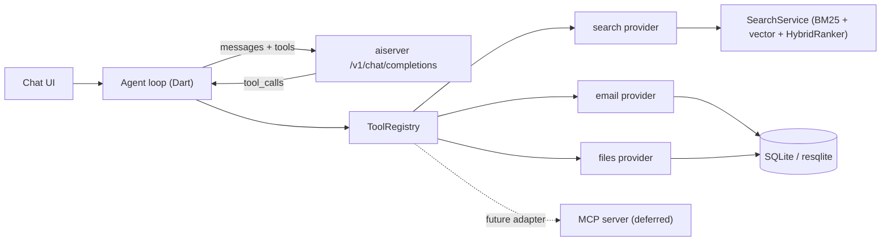

# ADR 0001: An in-process tool registry for giving the local LLM access to the archive

**Status:** Proposed
**Date:** 2026-10-18
**Deciders:** Mike Nimer
**Plan:** [docs/plans/llm-tools.md](../plans/llm-tools.md)

## Context

The chat feature runs Gemma 4 12B (Q4, GGUF) locally through `llama-cpp-python` in the
`aiserver` subprocess. Today the model can only see what we paste into the prompt. We want it
to look things up in the imported archive itself — files, emails and, later, photos — using the
keyword (BM25), vector and hybrid search we already have in `modules/search/`.

What we found when evaluating this:

- **The model can call tools.** Gemma 4's chat template, embedded in the GGUF, accepts a `tools`
  list and has a native format for emitting tool calls.
- **Our serving stack doesn't pass tools through.**
  - `ChatCompletionRequest` and `ChatMessage` in `aiserver/src/aichat/models.py` have no `tools`,
    `tool_choice`, `tool_calls` or `tool_call_id` fields, and no `tool` role. Pydantic silently
    drops them.
  - `llama-cpp-python` 0.3.31's `Gemma4ChatHandler` (a bare subclass of `MTMDChatHandler`) renders
    `tools` into the template. But it only returns structured `tool_calls` when one function is
    forced via `tool_choice`. With `tool_choice: "auto"`, the call comes back as raw text in
    Gemma's format.
- **Small models degrade as the tool list grows.** A 12B model picks tools less accurately once
  it has more than roughly 10–15 of them, and does worst when they overlap
  (`search_files_semantic` vs `search_emails_semantic` vs `keyword_search_emails`). Every schema
  also costs prompt tokens on every turn.
- **Search is already unified.** `SearchService` takes one query string, parsed by `QueryParser`,
  with operators (`from:`, `to:`, `participant:`, `subject:`, `type:`, `after:`, `before:`,
  `in:`, `tag:`, `near:`, …). `SearchFilters` applies the same predicates to both retrievers, and
  `HybridRanker` merges email and file hits into one ranking.
- **We may want external agents later.** Claude Desktop, Cursor and similar MCP clients could one
  day query the archive. We reviewed PhotoCraft (storytold/photocraft), whose design is one
  registry of 500+ commands with the UI, CLI, JSON control channel and MCP server as thin
  adapters over it. Its MCP server exposes about 10 generic tools (`command_list` for discovery,
  `command_run`, `command_batch`, `doc_inspect`), not 500 individual ones.

## Decision

1. **One `ToolRegistry` in the Flutter client, on the main isolate.** Each tool is defined once:
   name, description, JSON schema, a read/write flag and a Dart handler. Tools live where the data
   lives, on the side of the app that owns the database connection and `SearchService`.

2. **Feature modules contribute tools; the model doesn't see module boundaries.** Each module
   registers a `ToolProvider` (`modules/email/…`, `modules/files/…`, `modules/search/…`, later
   `modules/photos/…`), following the existing `modules/<feature>/services/` layout. Module
   grouping is for organizing the code, not for the model.

3. **Gemma gets a small, curated set of cross-source tools (target ≤ 7):**

   | Tool | Purpose |
   |---|---|
   | `search(query, sources?, from?, to?, after?, before?, limit?)` | Hybrid search across the archive. The handler turns structured arguments into the existing query syntax (e.g. `type:email from:sarah after:2024-01-01 …`) and runs the same pipeline as the search page (a stateless core extracted from `SearchService`, which is itself bound to the search page's UI state), so filters behave exactly as they do in the search UI. |
   | `get_item(id)` | Full record (email body or file text/metadata) for an id returned by `search`, cut to fit a size budget. |
   | `get_email_thread(id)` | The conversation an email belongs to, as summaries. |
   | `list_items(source, after?, before?, sort?, limit?)` | Browse by recency or date range when there's no query, e.g. "what came in last week". |
   | `list_collections()` | What's been imported, so the model can scope a search or explain gaps. |

   Rules for the set:
   - **One `search` tool with a `sources` argument**, not one search tool per source or per
     retrieval method. Choosing BM25, vector or hybrid is our job, not the model's.
   - **Results are compact:** ids, titles, senders, dates and short snippets. Full content only
     comes back through `get_item`, so one call can't flood the context.
   - **Read-only at first.** No write or delete tools.

4. **The registry can filter tools by context.** A request carries the tools that fit where the
   user is (for example, email tools only in the email view). The registry does the filtering in
   code, never the model.

5. **The agent loop runs in Dart and calls the registry directly — no MCP inside the app.** The
   loop:
   - sends messages plus tool schemas to `aiserver`;
   - if the reply contains a tool call, validates the arguments against the schema and runs the
     handler;
   - adds a `tool` message with the result and loops, capped at 4 tool calls per user turn;
   - on invalid arguments, returns the validation error to the model once, then stops.

   Retries, routing and validation are code, not model calls.

6. **`aiserver` becomes a pass-through for tool calling.**
   - Add `tools` and `tool_choice` to `ChatCompletionRequest`.
   - Add the `tool` role and `tool_calls` / `tool_call_id` to `ChatMessage`.
   - Pass them to `create_chat_completion`.
   - Parse Gemma's tool-call output into OpenAI-style `tool_calls` for `auto` mode, in both the
     streaming and non-streaming paths.
   - Cloud passthrough providers get the same fields, since they support them natively.

7. **MCP is deferred, and planned as one more adapter.** If we ever expose the archive to
   external agents, it will be a single MCP server built on the same `ToolRegistry`, not one
   server per module. See *Future: external MCP adapter* below.

## Options considered

### A. One tool per module and retrieval method (e.g. 12–20 tools)

- Pros: easy to map 1:1 from the code.
- Cons: worse tool selection on a 12B model, many overlapping choices, more tokens per turn. It
  also forces the model to merge results across sources, which `HybridRanker` already does
  better.
- **Rejected.**

### B. PhotoCraft-style discovery (`list_tools` / `run_tool(id, params)`)

- Pros: keeps the prompt tiny however many capabilities we add.
- Cons: needs multiple round trips and free-form ids and parameters, which is where small models
  fail most. It suits Claude- or GPT-class agents, not Gemma 12B.
- **Rejected for Gemma; kept as an option for a future external MCP adapter.**

### C. One MCP server per module, used by Gemma too

- Pros: clear boundaries; external agents could use the same servers.
- Cons:
  - cross-source search breaks, because `HybridRanker` can't rank across servers;
  - N ports, tokens and config entries;
  - a JSON-RPC hop inside our own process for no benefit;
  - every server would still have to send writes back through the main isolate's single
    connection.
- **Rejected.**

### D. Curated cross-source tools over one in-process registry

- **Chosen.**

## Consequences

**Positive**

- Gemma gets real retrieval with a short, clear tool list.
- Tool behaviour matches the search UI exactly, because both go through `SearchService` and
  `SearchFilters`.
- New sources (photos, social) plug in as providers, often by adding a value to `sources` rather
  than a new tool.
- An external MCP server becomes a thin adapter instead of a rewrite.

**Negative / costs**

- We have to write and maintain a Gemma tool-call parser for `auto` mode until `llama-cpp-python`
  does this itself. It's a single point of failure if the output format changes between Gemma
  versions.
- The agent loop adds latency: each tool round trip is another generation. The generation lock
  serializes everything, so a long loop blocks other chat requests.
- The curated tool set is an editorial decision we'll need to revisit as sources are added.

**Risks**

- **Gemma 4 12B tool-call reliability is unmeasured.** This is the biggest unknown and must be
  checked before building UI on it (see *Validation*).
- **Prompt injection:** email and file contents are untrusted text going back into the model.
  While the tools are read-only the damage is limited, but this must be revisited before any
  write tool is added.

## Validation (before committing to the full build)

1. Prototype the `aiserver` pass-through and parser behind the existing endpoint.
2. Write a small eval of about 30 realistic prompts ("emails from Sarah about the lease last
   spring", "the PDF with my W-2", "what did I get last week") and measure, for both `auto` and
   forced `tool_choice`:
   - picking the right tool;
   - arguments that pass schema validation;
   - a correct final answer.
3. If `auto` mode isn't reliable enough, fall back to a two-step pattern: a grammar-constrained
   `response_format` call returning `{tool, args}` or `{answer}`, then the tool call. The
   registry and tool set stay the same.

## Future: external MCP adapter (deferred, not part of this decision)

Recorded so a later implementation starts from the agreed constraints:

- One server on top of the `ToolRegistry`, with namespaced tools (`emails.search`, `files.get`).
  It may also expose discovery tools for capable agents.
- Transports:
  - Streamable HTTP on `127.0.0.1` inside the app;
  - a stdio bridge binary for clients that launch servers (like PhotoCraft's bridge mode).
- **Off by default**, with a clear warning: connected agents usually send what they read to a
  cloud LLM, which cuts against the app's on-device promise.
- Security:
  - per-client bearer tokens (0600 files or Keychain), revocable in Settings;
  - `Host` and `Origin` checks against DNS rebinding;
  - scopes per client (read-only; allowed sources and collections);
  - output size caps;
  - an audit log of calls visible in the UI.
