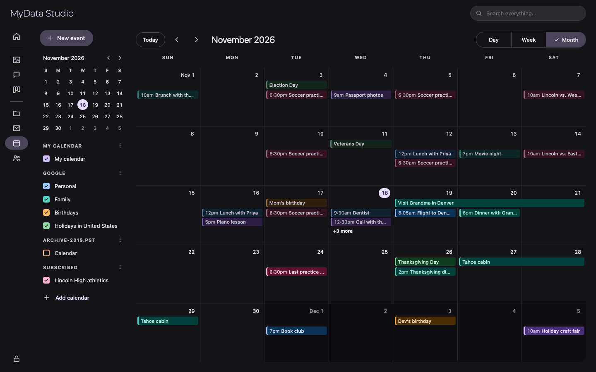
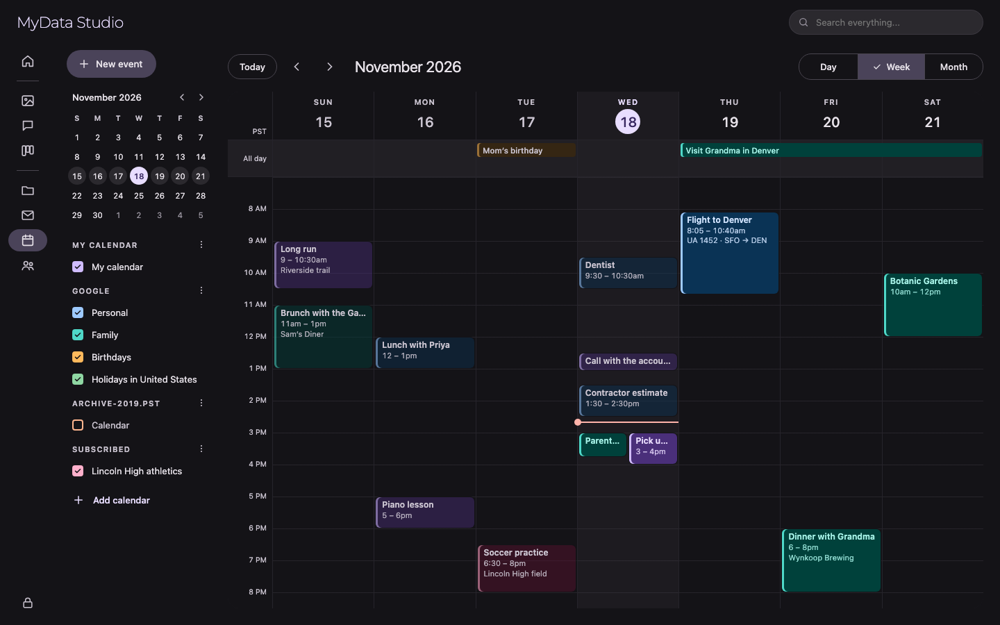
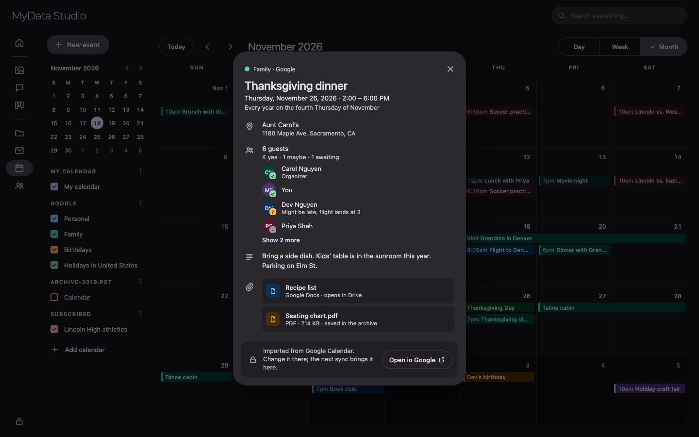
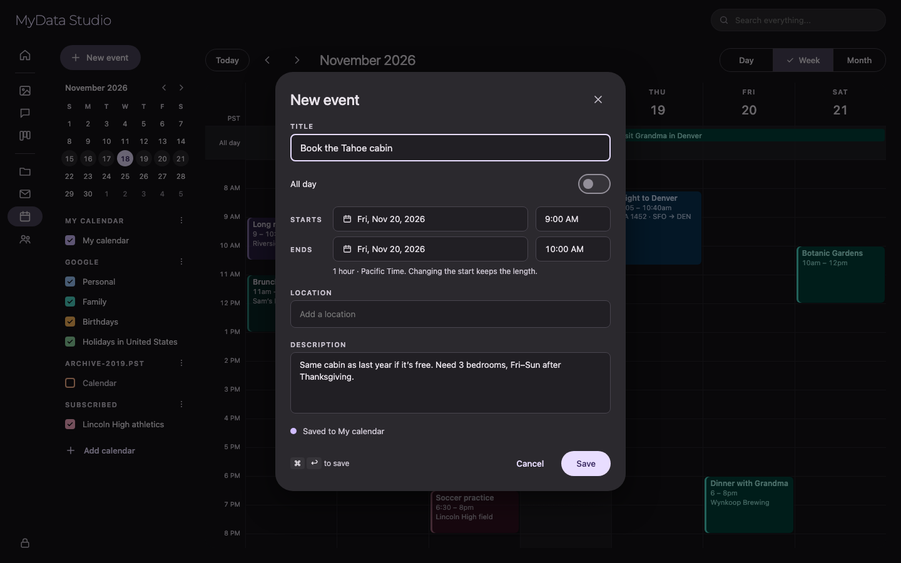
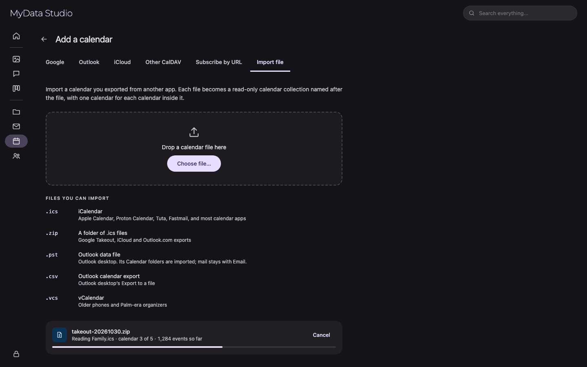

# Plan: Calendar app (from the `mockups/calendar-planner` prototype)

**Source:** `mockups/calendar-planner/`, a Google AI Studio React prototype (React 19, Tailwind,
`lucide-react`) running on mock data in `localStorage`, with "now" hard-coded to
2026-05-31 19:25 UTC. This plan rebuilds it as the **Calendar** app module in the Flutter client
(`client/lib/modules/calendar/`), stored in the SQLite archive. Calendar is a **collection
type** like Files, Email and Social (§5.2). Its rail entry sits in the `collections` group next
to them, and sources are added at `/calendar/add`, the same way `/email/add` works.

The prototype is a Google Calendar look-alike for one person's hand-entered events. The port
keeps its views and interactions, but its main job in My Data Studio is different: **showing the
calendars the user already has elsewhere** (Google, Outlook, iCloud, Outlook PST files,
exported `.ics` files) as an archive, next to one calendar of their own.

**Decisions (2026-10-26):**

| Question | Decision |
|---|---|
| Rail name | **Calendar** (route `/calendar`, module `modules/calendar/`, tables `calendar*`) |
| Collection type | **`calendar`, a fourth collection type** next to `file`, `email` and Social, with its own add-source page and **file imports** for exported calendars (`.ics`, `.zip`, `.vcs`, `.csv`), the way Email imports PST (§5) |
| Calendars | **Many calendars, each shown or hidden with a checkbox**, like Google Calendar. **Exactly one local calendar** ("My calendar") takes new events. Every other source adds **read-only calendars**: one per calendar that source has (a Google account brings its primary, Birthdays, Holidays, shared calendars…). |
| Where events come from | **Real calendar feeds and calendar exports only.** Calendars are **not rebuilt from invitation emails** in the mail archive. A PST's Calendar folder counts as a real calendar (C6). |
| Read-only rule | **Imported events are always read-only** (the original lives elsewhere). **Local events are always editable**, past or future. The prototype's "ended in the past = locked" rule is dropped. |
| Repeating events | **Shown from the first import phase** (C5), because nearly every real calendar has them. **Creating and editing** repeating local events comes later (C10). |
| All-day events | Supported from the first phase (the prototype declares `allDay` but never uses it). |
| Reminders | Later (C10), as desktop notifications. |
| Linking events to archive items | **Skipped.** Users don't attach emails or files to events by hand. |
| Attachments | **Supported for imported events** (Drive links on Google events, files on Outlook events, items in a PST, binary `ATTACH` in `.ics`). See §3.4. |
| Time | **Every instant is stored as UTC epoch milliseconds**, in the same format as the rest of the archive, and shown in the device's local time zone. The event's own IANA zone is kept beside it so repeats expand correctly across daylight-saving changes. All-day events follow the date rule in §3.2. |
| Semantic search | **Every event gets an embedding** (C11), like tasks |
| Look and feel | **Inherit the current app theme and shell** (§4), like Tasks. The prototype's Tailwind colours are not ported. |
| Colours | **One shared `AccentPalette`** (§4) for Calendar and Tasks, created by whichever app is built first |

Sections: [1](#1-prototype-inventory) inventories the prototype, [2](#2-what-changes-in-the-port)
says what we drop or change, [3](#3-data-model) is the schema and the date rules,
[4](#4-theme-and-styling-inherited-from-the-app) the theming,
[5](#5-calendar-sources) the import sources, [6](#6-flutter-architecture) the code layout, and
[7](#7-phases) the phases.

## Screens

Target designs, drawn in the app's theme and shell (§4) with sample data and "now" set to
Wed, Nov 18 2026, 2:40 PM. The source is the "Calendar app screens" design canvas. They show
intent; spacing and colour values come from §4, and the calendar colours stand in for the shared
`AccentPalette`.

**Month** (C1): the drawer with New event, the mini month, My calendar and one section per
source (a Google account, a PST file that is switched off, a subscribed calendar), and Add
calendar. The toolbar has Today, ‹ / ›, the range title and the Day | Week | Month switch. The
grid shows all-day and multi-day bars, chips in time order, quieter past events, "+3 more", and
dimmed days outside the month.



**Week** (C2): the all-day band, the time grid scrolled to 7 AM, today's shaded column with the
current-time line, overlapping events side by side, and tile text that grows with the tile's
height.



**Imported event details** (C1, C7): a read-only Google event with its repeat rule, location,
guests and their replies, description and attachments, and **Open in Google** instead of Edit
and Delete.



**New event** (C3): title, All day, start and end date and time (length kept when the start
changes), location and description. Events always go to My calendar, so there is no calendar
picker. Repeat and reminders arrive in C10.



**Add a calendar** (C5–C9): `/calendar/add` with one tab per source, showing the Import file tab,
the file types it accepts, and an import in progress.



## 1. Prototype inventory

### 1.1 Screen layout (`App.tsx`)

| Band | Size | Contents |
|---|---|---|
| **Header** | 64 high | Logo + "Calendar Planner" / "Workspace Engine"; **Today**, **‹** and **›** in one pill; the **range title**; a **view dropdown** (Day / Week / Month, with a check on the current one). |
| **Sidebar** | 272 wide | **Create Event** button; **mini month**; **My Calendars** list with an add-calendar form; a footer showing the simulated "now". |
| **Main** | flex | The current view (Month is the default), plus a floating **Reset Demo Data** button bottom-right. |
| **Toast** | bottom-right | Green success or amber warning, auto-dismissed after 4.5 s. |

**State:** the current date (the anchor the view is built around), the view, calendars, events,
the event being shown, the event being edited, the "create" prefill (date, start time, end
time), and the toast. Everything is saved to `localStorage` on every change.

### 1.2 Header (`Header.tsx`)

- **Today** jumps the anchor to "now" and shows a toast.
- **‹ / ›** step the anchor by one month, seven days or one day, depending on the view.
- **Range title:**
  - Month: "May 2026".
  - Week: "June 2026" if the week is in one month, "May – Jun 2026" if it crosses months,
    "Dec 2026 – Jan 2027" if it crosses years.
  - Day: "Sun, May 31, 2026".
- **View dropdown:** a menu that closes on outside click; the current view is bold with a check.

### 1.3 Sidebar (`Sidebar.tsx`, `MiniCalendar.tsx`)

- **Create Event** opens the event dialog empty (today, 09:00–10:00).
- **Mini month:**
  - its own month, browsed with its own ‹ / › without moving the main view;
  - a 6 × 7 grid starting on Sunday, with S M T W T F S headers;
  - days outside the month are dimmed; today has a ring; the anchor date is filled;
  - clicking a day sets the anchor (the main view stays on its current type).
- **My Calendars:** each row is a coloured checkbox, the name (struck through when hidden) and a
  colour dot. Clicking the row toggles visibility; hidden calendars' events disappear from every
  view. Five seed calendars, one of them hidden.
- **Add-calendar form** (folder-plus icon): name (required, 18 characters max) and one of five
  colours (indigo, emerald, rose, amber, violet). Create adds it checked and shows a toast.
  There's no rename, recolour or delete.
- **Footer:** "Baseline Base Time: May 31, 2026, 7:25 PM", with the note that earlier events are
  read-only.

### 1.4 Month view (`MonthView.tsx`)

- SUN … SAT header and **42 cells** (6 weeks from the Sunday on or before the 1st).
- Each cell shows the day number at the top right ("Jun 1" on the 1st), today as a filled circle,
  and days outside the month on a tinted background.
- Events that **start** that day are listed in start order as one-line chips: the start time in
  24-hour mono ("14:00"), then the title, in the calendar's colour. The list scrolls inside the
  cell when it overflows.
- **Hover** on a future event shows a small **edit** button. Past events are faded, dashed, with
  a lock icon and a not-allowed cursor.
- **Click a cell** → the create dialog for that date (09:00–10:00).
- **Click an event** → the details popup.
- **Drag an event to another cell** (HTML5 drag and drop) → it moves to that day, **keeping its
  start time and length**. Past events can't be dragged.

### 1.5 Week and day views (`WeekView.tsx`, `DayView.tsx`)

- A sticky header with the weekday (WED) and date for each of the 7 columns (or the one day,
  larger). Today's date is a filled circle.
- A scrolling **24-hour grid**: 56 px per hour (1344 px total), hour labels on the left ("1 AM" …
  "11 PM", nothing at midnight), a line under every hour. It **opens scrolled to 7 AM**.
- **Event tiles** are positioned by start and end time, with a 4 px colour bar on the left, the
  title, the time range when the tile is taller than 38 px, and (day view only) one line of
  description when it's at least 70 px. Minimum height 26 px; a zero-length event is drawn as
  30 minutes.
- **Hover** on a future tile raises it above its neighbours and shows the edit button.
- **Click an hour slot** → the create dialog at that hour (the code passes only a start time, so
  the end falls back to 10:00).
- **Drag across empty slots** (mouse down, move, mouse up) in one column → the slots highlight in
  a dashed box, and releasing opens the create dialog with that whole-hour range. Dragging into
  another column is ignored; releasing outside the grid cancels.
- **Drag an event to a slot** → it moves to that day and hour, **keeping its minutes** and
  length. Past events can't be dragged.

### 1.6 Event dialog (`EventModal.tsx`)

- A modal (max 512 wide) with a colour stripe in the selected calendar's colour, the title
  "Schedule New Event" or "Edit Planned Event", and a close X. Clicking the backdrop closes it.
- **Fields:**

  | Field | Control | Rules |
  |---|---|---|
  | Event Title | text, autofocus | required |
  | Start Timing | date + time | changing the start date past the end date moves the end date to match |
  | End Timing | date + time | must be after the start |
  | Calendar | select, with the colour dot | required; defaults to the first visible calendar |
  | Description | textarea, 3 rows | 200 characters max |

- **Validation** shows a red banner inside the form: missing title, missing calendar, or end not
  after start.
- **Footer:** a hint ("Drag elements later to reschedule"), **Cancel**, and **Create Event** /
  **Save Changes** in the calendar's colour. Saving shows a toast.

### 1.7 Details popup (`EventDetailsPopover.tsx`)

- A centred modal (despite the name), with a colour stripe, the calendar's dot and name, and
  **Edit**, **Delete** and close buttons. Edit and Delete only appear for future events.
- **Body:** the title; the date ("Sunday, May 31, 2026") and time range ("8:00 PM – 9:30 PM");
  the description, or "No description added."; and a status box: "Historical Event (Read-Only)"
  or "Scheduled Event (Active)".
- **Delete is immediate**, with no confirmation; a toast follows.

### 1.8 Prototype bugs not to copy

- "Now" is a constant (`SYSTEM_NOW`), so "today", past/future and the defaults never move.
- **Overlapping events are drawn on top of each other** in week and day views (`left-1 right-1`
  for every tile).
- **Events that cross midnight** are only drawn on their first day, and their tile runs off the
  bottom of the grid.
- `allDay` is in the type but never set or drawn.
- Events are matched to days with `isSameDay(start, day)`, so a multi-day event shows only on its
  first day in month view too.
- Clicking an hour slot passes no end time, so a 3 PM click creates 15:00–10:00 and fails
  validation.
- Dropping in week/day view keeps the old minutes, so you can't move 9:30 to 10:00 by dragging.
- Drag-to-create only works on whole hours.
- Calendar ids and event ids come from `Date.now()`.
- Delete has no confirmation or undo.
- Calendars can't be renamed, recoloured or deleted.
- The 200-character description limit cuts off real descriptions.

## 2. What changes in the port

**Dropped:**
- The logo, "Workspace Engine", the simulated-time footer, **Reset Demo Data** and the seed data.
- The "past = read-only" rule, its lock icon, dashed tiles and status box (decision above).
- The add-calendar form with its five colours, and the Calendar field in the event dialog: there
  is one writable calendar.
- Toasts become the app's `SnackBar`s.

**Changed:**
- "Now" is the real clock, refreshed every minute, so today, the current-time line and past
  styling move on their own.
- **Read-only comes from the calendar**, not the time: imported events have no edit, delete or
  drag, and their details say where they came from, with **Open in Google Calendar / Outlook**
  when the source gives a link.
- **Past events look quieter** (`onSurfaceVariant` text, lighter fill), like Google Calendar, but
  stay fully usable.
- The view dropdown becomes a **`SegmentedButton`** (Day | Week | Month). Three options fit, and
  it saves a click.
- **The week starts on the locale's first day** (`MaterialLocalizations.firstDayOfWeekIndex`),
  and times follow the system's 12/24-hour setting (`MediaQuery.alwaysUse24HourFormat`), not a
  hard-coded US format.
- **Overlapping events are laid out side by side** (§6, `day_layout.dart`).
- **Multi-day and all-day events** show as bars across the month's week rows, and in an
  **all-day band** above the time grid in week and day views. A timed event that crosses
  midnight is drawn on each day it touches.
- **Month cells don't scroll.** They show as many chips as fit, then **"+N more"**, which opens
  that day's list.
- **Week and day views gain a current-time line** in today's column, and open scrolled to an hour
  before now when today is visible (otherwise 7 AM).
- **Drag snaps to 15 minutes** (moving, creating and resizing), using the pointer's position
  rather than the hour slot.
- **Resize by dragging an event's bottom edge** (new; Google Calendar has it, the prototype
  doesn't).
- **Clicking an empty slot** creates a one-hour event starting at the clicked quarter-hour.
- **Changing the start keeps the event's length** (Google's behaviour), instead of only pushing
  the end date.
- **The editor gains** All day, Location, and later Repeat and Reminders; the description has no
  short limit.
- **Delete asks first** (`AlertDialog`), like the rest of the app.
- **Imported events show more**: location, organiser and attendees with their responses,
  attachments, and the source calendar.
- **Keyboard shortcuts** (Google's): `t` today, `d`/`w`/`m` views, `j`/`k` or ←/→ previous and
  next, `c` new event, `Esc` closes dialogs and cancels drags. They're registered in the app's
  existing shortcuts sheet (`keyboard_shortcuts_modal.dart`).

## 3. Data model

Raw DDL appended to `AppDatabase.schemaDDL` (no code generation; see `CLAUDE.md`), with plain
Dart models in `models/tables/` and hand-written `fromMap`/`toMap`. Conventions match the
existing tables: `TEXT` UUID keys, `INTEGER` epoch-millisecond timestamps, and foreign keys
with explicit `ON DELETE` (resqlite enables `PRAGMA foreign_keys` on every connection).

### 3.1 Tables

```sql
CREATE TABLE IF NOT EXISTS calendars (
  id TEXT PRIMARY KEY,
  collection_id TEXT,                    -- the source account or file; NULL for the local calendar
  source_calendar_id TEXT,               -- Google calendarId, Graph calendar id, CalDAV href, ics URL/file
  name TEXT NOT NULL,                    -- user-editable; starts as the source's name
  source_name TEXT,                      -- the source's own name, so a rename at the source can be shown
  color TEXT NOT NULL DEFAULT 'blue',    -- AccentPalette key (§4)
  source_color TEXT,                     -- the source's hex colour, kept for reference
  is_local INTEGER NOT NULL DEFAULT 0,
  is_visible INTEGER NOT NULL DEFAULT 1, -- the drawer checkbox
  time_zone TEXT,                        -- the calendar's default IANA zone
  position REAL NOT NULL DEFAULT 0,      -- order within its drawer section
  sync_token TEXT,                       -- Google nextSyncToken / Graph deltaLink / CalDAV sync-token / ics ETag
  last_synced_at INTEGER,
  created_at INTEGER NOT NULL,
  updated_at INTEGER NOT NULL,
  FOREIGN KEY (collection_id) REFERENCES collections(id) ON DELETE CASCADE
);
-- Exactly one local calendar.
CREATE UNIQUE INDEX IF NOT EXISTS idx_calendars_one_local ON calendars(is_local) WHERE is_local = 1;
CREATE UNIQUE INDEX IF NOT EXISTS idx_calendars_source
  ON calendars(collection_id, source_calendar_id) WHERE collection_id IS NOT NULL;

CREATE TABLE IF NOT EXISTS calendar_events (
  id TEXT PRIMARY KEY,
  calendar_id TEXT NOT NULL,
  source_event_id TEXT,                  -- the provider's id (NULL for local events)
  ical_uid TEXT,                         -- iCalendar UID: matches the same event across sources
  title TEXT NOT NULL DEFAULT '',
  description TEXT NOT NULL DEFAULT '',  -- plain text
  description_html TEXT,                 -- the source's HTML body, when it had one
  location TEXT,
  start_utc INTEGER NOT NULL,            -- epoch ms, UTC; all-day: see §3.2
  end_utc INTEGER NOT NULL,              -- exclusive
  is_all_day INTEGER NOT NULL DEFAULT 0,
  time_zone TEXT,                        -- IANA zone the event was written in; NULL when all-day
  rrule TEXT,                            -- RFC 5545 RRULE, series masters only
  rdates TEXT,                           -- JSON array of extra occurrence starts (epoch ms)
  exdates TEXT,                          -- JSON array of removed occurrence starts (epoch ms)
  recurrence_until_utc INTEGER,          -- end of the last occurrence; NULL = repeats forever
  recurring_event_id TEXT,               -- on an exception: its series master
  original_start_utc INTEGER,            -- on an exception: the occurrence it replaces
  status TEXT NOT NULL DEFAULT 'confirmed'
    CHECK (status IN ('confirmed', 'tentative', 'cancelled')),
  color TEXT,                            -- per-event colour from the source (AccentPalette key), else NULL
  organizer_name TEXT,
  organizer_email TEXT,
  html_link TEXT,                        -- "Open in Google Calendar / Outlook"
  source_updated_at INTEGER,
  created_at INTEGER NOT NULL,
  updated_at INTEGER NOT NULL,
  FOREIGN KEY (calendar_id) REFERENCES calendars(id) ON DELETE CASCADE,
  FOREIGN KEY (recurring_event_id) REFERENCES calendar_events(id) ON DELETE CASCADE
);
CREATE INDEX IF NOT EXISTS idx_calendar_events_range ON calendar_events(calendar_id, start_utc, end_utc);
CREATE INDEX IF NOT EXISTS idx_calendar_events_series
  ON calendar_events(calendar_id, recurrence_until_utc) WHERE rrule IS NOT NULL;
CREATE INDEX IF NOT EXISTS idx_calendar_events_exceptions
  ON calendar_events(recurring_event_id, original_start_utc) WHERE recurring_event_id IS NOT NULL;
CREATE INDEX IF NOT EXISTS idx_calendar_events_uid ON calendar_events(ical_uid);
CREATE UNIQUE INDEX IF NOT EXISTS idx_calendar_events_source
  ON calendar_events(calendar_id, source_event_id) WHERE source_event_id IS NOT NULL;

CREATE TABLE IF NOT EXISTS calendar_event_attendees (
  event_id TEXT NOT NULL,
  email TEXT NOT NULL COLLATE NOCASE,
  name TEXT,
  response TEXT NOT NULL DEFAULT 'needs_action'
    CHECK (response IN ('needs_action', 'accepted', 'declined', 'tentative')),
  is_organizer INTEGER NOT NULL DEFAULT 0,
  is_self INTEGER NOT NULL DEFAULT 0,    -- the account owner; their response drives tile styling
  is_optional INTEGER NOT NULL DEFAULT 0,
  PRIMARY KEY (event_id, email),
  FOREIGN KEY (event_id) REFERENCES calendar_events(id) ON DELETE CASCADE
);

CREATE TABLE IF NOT EXISTS calendar_event_attachments (
  id TEXT PRIMARY KEY,
  event_id TEXT NOT NULL,
  title TEXT NOT NULL,
  mime_type TEXT,
  size INTEGER,
  url TEXT,                              -- link attachments (Drive, OneDrive, ATTACH;VALUE=URI)
  source_attachment_id TEXT,             -- Drive fileId / Graph attachment id
  file_id TEXT,                          -- the archived copy, or an already-indexed Drive file
  position INTEGER NOT NULL DEFAULT 0,
  FOREIGN KEY (event_id) REFERENCES calendar_events(id) ON DELETE CASCADE,
  FOREIGN KEY (file_id) REFERENCES files(id) ON DELETE SET NULL
);
CREATE INDEX IF NOT EXISTS idx_calendar_event_attachments_event ON calendar_event_attachments(event_id, position);
```

**Verify before C0:** whether `collections` rows are ever deleted with foreign keys pointing at
them today. Emails and files reference `collection_id` without an FK and are cleared by the
collection-delete path. If that path deletes the collection row first, the `ON DELETE CASCADE`
above is what removes calendars; either way, the collection-delete path gets an explicit
`DELETE FROM calendars WHERE collection_id = ?` so it doesn't depend on the FK.

Reminders (C10) add one more table, created in C10 rather than C0 because nothing reads it
before then:

```sql
CREATE TABLE IF NOT EXISTS calendar_event_reminders (
  event_id TEXT NOT NULL,
  minutes_before INTEGER NOT NULL,
  PRIMARY KEY (event_id, minutes_before),
  FOREIGN KEY (event_id) REFERENCES calendar_events(id) ON DELETE CASCADE
);
```

### 3.2 Date and time rules

1. **Instants are UTC epoch milliseconds.** `start_utc` / `end_utc` and every other `*_utc` or
   `*_at` column. The UI converts to the device's zone for display and back when saving.
2. **Every timed event keeps its IANA `time_zone`** (from the source, or the device's zone for
   local events, read with `flutter_timezone`). Display never uses it, but **repeat expansion
   must**: a weekly 9:00 meeting in `America/Chicago` stays at 9:00 Chicago time across the DST
   change, so its UTC instant moves by an hour. Expansion runs in the event's zone with the
   `timezone` package, then converts each occurrence to UTC.
3. **All-day events store their dates at 00:00 UTC.** A birthday on 1 June is `start_utc` =
   2026-06-01T00:00Z and `end_utc` = 2026-06-02T00:00Z (exclusive), with `is_all_day = 1` and no
   `time_zone`. They are **never converted to local time**: the UI reads the UTC date parts
   directly. Otherwise the same birthday shows on 31 May for anyone west of Greenwich. This keeps
   one column format in the database (the decision) while treating all-day dates as dates.
4. **Floating times** (an `.ics` time with no zone) are read in the device's zone at import, and
   that zone is recorded in `time_zone`.
5. **Windows zone names** ("Eastern Standard Time", common in Outlook and Exchange `.ics` files)
   are mapped to IANA ids with CLDR's `windowsZones.xml` table, bundled as a Dart constant.
6. **The editor shows an inclusive end date for all-day events** ("1 Jun – 3 Jun") and stores
   the exclusive one (4 Jun 00:00Z).
7. **Range queries use half-open intervals.** An event is in `[from, to)` when
   `start_utc < to AND end_utc > from`, so an event ending exactly at midnight isn't drawn on the
   next day.

### 3.3 Repeating events

- **A series is one row** with `rrule` (plus `rdates` / `exdates`). Occurrences are **expanded
  when read**, only for the visible range, never stored. A series that repeats forever costs one
  row.
- **An exception** (one occurrence moved, renamed or cancelled at the source) is its own row with
  `recurring_event_id` and `original_start_utc`. A cancelled occurrence is an exception with
  `status = 'cancelled'`, or an entry in `exdates`, depending on how the source reports it.
- **`recurrence_until_utc`** is computed on save (from `UNTIL`, or by expanding `COUNT`), so the
  range query can skip finished series without expanding them.
- **`RecurrenceExpander`** (pure Dart, §6) takes a master, its exceptions and a range, and
  returns occurrences:
  1. expand the RRULE and `rdates` in the event's zone;
  2. remove `exdates` and the starts that exceptions replace;
  3. add the exceptions that fall in range, except cancelled ones.
- **Library:** the `rrule` package for RFC 5545 expansion, **verify it is maintained** and that
  it handles `BYSETPOS`, `BYDAY` with ordinals (`2TU`, `-1FR`), `WKST`, and `COUNT` with
  `exdates`. If it doesn't, write the expander for the rules real calendars use (daily, weekly by
  day, monthly by date or by nth weekday, yearly) and test it against the RFC 5545 examples.

### 3.4 Attachments

Users don't attach things to events by hand (decision), but imported events often have
attachments. Each source gives one of two kinds:

| Kind | Sources | Stored as |
|---|---|---|
| **A file inside the event** | Outlook `fileAttachment`; `.ics` `ATTACH;ENCODING=BASE64;VALUE=BINARY`; CalDAV binary attachments; **PST appointment attachments** | **Downloaded into the archive** as a `files` row in the calendar's collection (the same storage email attachments use), with `calendar_event_attachments.file_id` pointing at it. These only exist inside the event, so they're always kept. |
| **A link to a file elsewhere** | Google `attachments[]` (Drive links with `fileId`, `title`, `mimeType`); Outlook `referenceAttachment` (OneDrive/SharePoint); `ATTACH;VALUE=URI` | **Kept as a link** (`url`, `title`, `mime_type`). If a Drive or OneDrive collection already indexed that file, `file_id` points at its `files` row, so it opens from the archive. Otherwise the link opens in the browser, and **Save to archive** downloads it on request. |

- Downloaded attachments are ordinary `files` rows, so they get thumbnails, text extraction,
  embeddings and search like every other file, without calendar-specific work.
- **They follow whatever the Files and Photos views already do with email attachments**
  (`files.email_id`): verify how those views include or exclude attachment rows, and apply the
  same rule via the `calendar_event_attachments` join.
- Outlook item attachments (an email attached to an event) are listed by title only, and not
  downloaded, until someone needs them.
- **Matching Drive links:** verify which `files` column holds the Drive file id for Drive
  collections, and look it up there.

### 3.5 Repository API

`CalendarRepository` in `repositories/`:

- **Calendars:** `ensureLocalCalendar()` (creates "My calendar" on first open), `calendars()`
  grouped by collection, `setVisible(id, visible)`, `rename(id, name)`, `setColor(id, key)`,
  `reorder(id, position)`.
- **Reading:** `occurrencesBetween(DateTime fromUtc, DateTime toUtc, Set<String> calendarIds)`
  returns a list of `CalendarOccurrence` (the event plus this occurrence's start and end, and
  whether it repeats). It runs three queries: single events in range, series that overlap the
  range, and their exceptions. Then it expands with `RecurrenceExpander`. `event(id)` loads one
  event with its attendees and attachments.
- **Local writes** (they throw if the event's calendar isn't local): `createEvent`,
  `updateEvent`, `moveEvent(id, newStartUtc, newEndUtc)`, `deleteEvent`, and in C10
  `updateOccurrence` / `updateFollowing` / `updateSeries` and the matching deletes.
- **Source writes** (used by scanners through the main-isolate write relay, not by the UI):
  `upsertCalendar`, `upsertEvents` (by `calendar_id` + `source_event_id`, including attendees
  and attachments), `deleteEventsBySourceIds`, `replaceCalendarContents` (a full resync), and
  `setSyncToken`.

## 4. Theme and styling: inherited from the app

Like Tasks, Calendar adds **no fonts or shapes of its own**, and only one named colour set.
Everything else comes from `_buildTheme` in `family_dam_app.dart`, `color_schemes.g.dart`,
`DESIGN.md` and the shell's widgets.

| App today | Calendar uses it for |
|---|---|
| **Dark only:** the dark `ColorScheme` (obsidian surfaces, lavender `primary`) | Every colour via `Theme.of(context).colorScheme`, except the calendar colours below. No hex values in `modules/calendar/`. The light scheme must still look right. |
| **System font** with the sizes in `_buildTheme`'s `textTheme` (`DESIGN.md` §Typography) | `titleLarge` the range title; `labelSmall` weekday headers (micro-caps, as `DESIGN.md` describes) and hour labels; `bodySmall` month chips and tile text; `titleSmall` tile titles; `headlineSmall` the details title. Hour labels use the system font with tabular figures, not mono. |
| **Surface scale** | View background `surface`; days outside the month `surfaceContainerLowest`; today's column `surfaceContainerLow`; hover and drag-over `surfaceContainerHigh`; the all-day band `surfaceContainer`. |
| **"The No-Line Rule":** `dividerColor` transparent | **The grid lines are the exception that needs a decision.** A calendar grid can't be read without them. Use hairlines in `outlineVariant` at low opacity (about 30%), drawn by one `CustomPainter`, and no other dividers (none in the drawer, dialogs or header). Flagged for `DESIGN.md` in C1. |
| **Today and selection** | Today's date: a filled `primary` circle with `onPrimary` text (the prototype's blue circle). The mini month's anchor date: `primaryContainer`. The current-time line: 2 px `error` with a dot, like Google's red line. |
| **Shell:** `RoutePage` + `NavigationWrapper(body:, drawer:)` | `/calendar` → `NavigationWrapper(body: CalendarPage, drawer: CalendarDrawer)`. |
| **Drawers:** `DrawerSection` / `DrawerNavItem`, 240 px wide | `CalendarDrawer` uses `DrawerSection` for **My calendar** and one section per source account. Calendar rows are new (checkbox + name + menu) but sized like `DrawerNavItem`. Tasks' plan already proposes moving the two drawer widgets to `lib/widgets/drawer/` when a second module needs them; whichever app lands second does that move as its own small change. |
| **`DESIGN.md` components:** icon-only toolbar buttons with a circular hover; panel radius 16; primary buttons | ‹ / › and the drawer's add button; dialog panels; **New event** is a `FilledButton.tonal` with a + icon (the prototype's pill). |
| **Dialogs:** `Dialog` / `AlertDialog` on the default M3 theme | The editor (max 560 wide) and details (max 480 wide) are `Dialog`s. Delete and "Discard changes?" are `AlertDialog`s. |
| **Glass** ([glassmorphism-elevation.md](glassmorphism-elevation.md), not built) | Use its widgets if they exist by then; otherwise the flat `surfaceContainer*` scale. |

**The one addition: an `AccentPalette` `ThemeExtension`.** Calendars need about a dozen colours
that stay distinguishable and readable in both the dark and light schemes. The `ColorScheme` has
none to spare (`tertiary` is reserved for files). The palette has **12 named hues** (`blue`,
`teal`, `green`, `lime`, `amber`, `orange`, `red`, `pink`, `purple`, `indigo`, `brown`,
`graphite`). Each is a `(accent, container, onContainer)` triple, with dark and light values.

- **Event tiles and chips:** a `container` fill, a 3 px `accent` bar on the left, and
  `onContainer` text. **Past events** use a lower-alpha container and `onSurfaceVariant` text.
  **Tentative** events (or ones the user answered "maybe") get an outline instead of a fill.
  **Declined** events get a line-through.
- **Source colours** (Google's `backgroundColor`, Outlook's `hexColor`) are mapped to the
  nearest hue on import (`source_color` keeps the original), so imports never bring in
  colours that fail contrast against our theme.
- A widget test checks **WCAG AA** for `onContainer` on `container` for every hue, in both
  schemes.
- **Shared with Tasks:** Tasks' plan adds a small `TaskColors` extension (danger, warning,
  success, …) for the same reason. These must not become two unrelated palettes. **Whichever app
  is built first creates `AccentPalette` in `lib/theme/`** (decided 2026-10-26), and
  `TaskColors` maps its `success` / `warning` / `info` keys onto palette hues (Tasks plan §4).

**Motion:** 150–200 ms, `Curves.easeOutCubic`, the same as Tasks: view switches cross-fade, and
a dropped event animates to its snapped slot.

## 5. Calendar sources

### 5.1 One API per service? Mostly, but fewer than it looks

Calendars are like email. The two biggest services have their own APIs, most of the rest share
one standard, and some offer only an export file:

| How you get the calendar | Services | Built in |
|---|---|---|
| **A service's own API** | **Google** (Calendar API v3), **Microsoft** Outlook.com / Microsoft 365 (Graph) | one connector each: C7, C8 |
| **CalDAV**, the open standard (calendars' equivalent of IMAP) | **iCloud, Fastmail, Yahoo, Zoho, GMX, mailbox.org, Synology Calendar, Nextcloud**, and any self-hosted server | **one shared connector** with per-provider presets: C9 |
| **An `.ics` link** (read-only, polled) | holidays, schools, sports teams, and the "secret address" Google, Outlook and iCloud give out | one connector: C9 |
| **Export files only** | **Proton Calendar** and **Tuta** (no CalDAV), **Google Takeout**, Apple Calendar, Outlook desktop (`.pst`, `.csv`), old phones | **file import**: C5, plus `.pst` in C6, like Email's PST tab |

So there are four connectors to write (Google, Microsoft, CalDAV, `.ics` links) plus file
imports, not one per service. CalDAV is the same trade the email plans made with the shared
[IMAP engine](email-imap-engine.md).

### 5.2 The Calendar collection type

Calendar works like the existing collection types, using the same pieces:

- **`collections.type = 'calendar'`**, with scanner constants in `AppConstants` next to the
  email and file ones: `calendar.google`, `calendar.outlook`, `calendar.caldav`,
  `calendar.ics_url`, `calendar.file` (one-time imports, including PST), and later
  `calendar.macos`. Sign-in, tokens, `needs_re_auth`, sync status, **Sync now** and removal reuse
  the collection machinery unchanged.
- **One collection per account or imported file.** Each calendar it brings is a `calendars` row
  with that `collection_id`. **All of them are read-only.** The local calendar is the only
  `calendars` row without a collection.
- **Rail:** the seed row moves to `group: 'collections'`, next to Files, Email and Social.
- **Adding sources: `/calendar/add` → `NewCalendarPage`**, built like `NewEmailPage`: a `TabBar`
  with one tab per source, and the same sign-in states (idle, loading, success, error). The
  tabs are **Google**, **Outlook**, **iCloud**, **Other CalDAV** (with Fastmail, Yahoo, Zoho,
  GMX, mailbox.org, Synology and Nextcloud presets), **Subscribe by URL** and **Import file**.
  Each tab arrives with its phase. The drawer's **Add calendar** button opens this page, as
  Email's drawer does for `/email/add`.
- **Drawer:** `CalendarDrawer` lists My calendar, then one `DrawerSection` per calendar
  collection (the account, or the imported file's name), like `EmailDrawer` lists email
  collections. Each section's menu has Sync now (live sources), Settings and Remove.
- **Email collections don't create calendars.** Gmail, Yahoo and Outlook mail only give mail
  access, so they can't reach the account's calendar. A connected mail account's calendar is
  added as its own calendar collection (Google, Outlook or CalDAV tab), and invitation emails
  stay emails.

### 5.3 Live sources

| Source | Phase | Scanner | Auth | Notes |
|---|---|---|---|---|
| **Google Calendar** | C7 | `calendar.google` | Google OAuth: a new `LoginProviders.googleCalendar` with `calendar.readonly` (a **sensitive scope**, so the same verification note as Drive's `drive` scope) | `calendarList.list`, then `events.list` per calendar with `singleEvents=false` and `showDeleted=true`, and **no `timeMin`** (the whole history: it's an archive). Store `nextSyncToken`; on `410 Gone`, do a full resync. Exceptions arrive with `recurringEventId` + `originalStartTime`. Event `colorId`s are mapped through `colors.get`. |
| **Outlook / Microsoft 365** | C8 | `calendar.outlook` | Microsoft OAuth: a new `LoginProviders.outlookCalendar` with Graph `Calendars.Read` + `offline_access`. **Separate from the mail sign-in**: the mail token is for `outlook.office.com` IMAP, and a token can only be for one resource (the existing code notes that adding Graph to the mail login conflicted). | `GET /me/calendars`, then events per calendar. Graph sends recurrence as `patternedRecurrence` JSON, which is converted to an RRULE (daily, weekly, absolute/relative monthly, absolute/relative yearly; end date, count or no end). Exceptions and cancelled occurrences come from `/instances` (or `cancelledOccurrences` / `exceptionOccurrences`, **verify which exist in v1.0**). Ongoing changes come from `calendarView/delta` over a rolling window. Attachments via `$expand=attachments`, downloading `fileAttachment`s with `/$value`. Work and school tenants may need admin consent; reuse [email-outlook.md](email-outlook.md)'s explanation for that. |
| **CalDAV**: iCloud, Fastmail, Yahoo, Synology Calendar, Nextcloud, any server | C9 | `calendar.caldav` | the server URL + username + **app-specific password**, stored like the IMAP plans' credentials. iCloud and Fastmail can reuse the app password their email plans already collect, with the user's permission. | Discovery: `/.well-known/caldav` → `current-user-principal` → `calendar-home-set` → `PROPFIND` depth 1. Sync with the `sync-collection` REPORT (RFC 6578), falling back to comparing ctags/ETags; fetch with `calendar-multiget`; parse with the same iCalendar parser as `.ics`. No Dart CalDAV client is assumed (**verify**): it's built on `http` + `xml`, both already dependencies. |
| **Subscribed calendar URLs** (`webcal://` / `https://…ics`: holidays, school, sports) | C9 | `calendar.ics_url` | none | The `.ics` importer on a timer (default every 12 hours), using `ETag` / `If-Modified-Since`. |
| **macOS Calendar** (EventKit) | C12 | `calendar.macos` | macOS calendar permission (an entitlement + `NSCalendarsFullAccessUsageDescription`) | Reads every account the Mac already syncs, including Exchange, with no sign-in. EventKit has no attachments, and connecting it **as well as** Google or Outlook duplicates those calendars, so the UI warns. macOS-only. |

### 5.4 Export files (the **Import file** tab)

One-time imports, like Email's **Outlook PST** tab: pick a file, a one-time import isolate
reads it (scanner `calendar.file`), and it becomes **one collection named after the file**, with
one calendar per calendar inside it.

| Format | Where it comes from | Phase | Notes |
|---|---|---|---|
| **`.ics`** (iCalendar) | Almost everything: Google (per calendar), Apple Calendar (**File › Export**), Outlook (**Save Calendar**), Yahoo, Fastmail, **Proton**, **Tuta**, Thunderbird | C5 | The shared parser below. One calendar per file, named from `X-WR-CALNAME`, else the file name. |
| **`.zip`** of `.ics` | **Google Takeout** (`Takeout/Calendar/*.ics`, one per calendar), Fastmail and Nextcloud bulk exports | C5 | Each `.ics` inside becomes a calendar in the same collection. |
| **`.vcs`** (vCalendar 1.0) | Older Outlook versions, Palm, old Nokia and Samsung phones | C5 | iCalendar's predecessor: quoted-printable text, `TZ`/`DAYLIGHT` instead of `VTIMEZONE`, and a different repeat syntax (`W1 MO #10`), converted to RRULE. Read by the same parser in a vCalendar mode. |
| **`.csv`** | Outlook's **Export to a file › CSV** calendar export, and spreadsheets in the same columns (the format Google Calendar also imports) | C5 | Columns: Subject, Start Date, Start Time, End Date, End Time, All day event, Description, Location (plus Outlook's optional ones). Matched by header name, with date formats detected from the rows. **No repeats**: Outlook writes each occurrence as its own row. |
| **`.pst`** | Outlook for Windows | C6 | The same file Email's PST tab imports: its Calendar folders, read by `pst_parser.py`, with the binary repeat blob (MS-OXOCAL) converted to RRULE. Email's PST tab offers to import the calendar at the same time. |
| **`.olm`** | Outlook for Mac archives | C12 | A zip of XML. Decided together with [email-file-imports.md](email-file-imports.md)'s OLM question. |
| **Apple `.icbu`** (Calendar archive) | Apple Calendar's **Calendar Archive** | C12 | A bundle with its own internal layout (**verify**). Until then, the help text asks for **File › Export** per calendar (`.ics`). |
| **Facebook events** | the Facebook data export (`your_events…json`) | C12 | Belongs to [social-facebook-sync.md](social-facebook-sync.md)'s export import, which can add a read-only "Facebook events" calendar. |

- **Importing the same file again** into its collection (**Import again** in the section menu)
  updates events by `UID` + `RECURRENCE-ID` (or a row hash for `.csv`) and deletes the ones that
  are gone. Importing it as a new file creates a second collection, as PST does today.
- **Large files:** stream-parse, as the MBOX plan does for Takeout mail. A busy calendar
  exported from 15 years of use is tens of MB.
- **Failures:** a file with a bad event imports the rest and reports "Imported 2,341 events;
  3 couldn't be read" with the line numbers in the log.

**Shared iCalendar parser** (`services/ical/`), used by `.ics`, `.vcs` and CalDAV:
- line unfolding, parameters, and text escaping;
- `VEVENT`, `VTIMEZONE`, `RRULE` / `RDATE` / `EXDATE`, `RECURRENCE-ID`, `ATTENDEE`, `ORGANIZER`,
  `ATTACH`, `STATUS`, `SEQUENCE`, `METHOD`;
- `DATE` vs `DATE-TIME`, `TZID`s (IANA, Windows names via CLDR, or the file's own
  `VTIMEZONE`).

Use `enough_icalendar` (same author as the `enough_mail` package the app already depends on)
**if it is maintained and passes our tests**; otherwise write a small RFC 5545 reader. Either
way, a corpus of real `.ics` files (Google, Outlook, Apple, Fastmail, Proton) goes in
`test/fixtures/ical/`.

**Scanners follow the app's rules** (`CLAUDE.md`): they run in isolates, read through their own
connection, **write through the main isolate** (`writeViaMain()` with a `SequentialWriteQueue`
for listener-based ones), and register in `ScannerManager`. The embedding isolates pause while
they sync.

## 6. Flutter architecture

```text
client/lib/modules/calendar/
  pages/
    calendar_page.dart             # /calendar?view=week&date=2026-06-01
    new_calendar_page.dart         # /calendar/add: one tab per source (§5.2)
  widgets/
    calendar_drawer.dart           # New event, mini month, My calendar, one section per source, Add calendar
    mini_month.dart
    calendar_row.dart              # checkbox + colour + name + menu (Only this, Colour, Rename, Sync now, Settings)
    calendar_toolbar.dart          # Today, ‹ ›, range title, Day | Week | Month
    month_view.dart                # weeks of the month
    month_week_row.dart            # day numbers, spanning bars, chips, "+N more"
    day_overflow_popover.dart
    time_grid_view.dart            # day and week (1 or 7 columns): header, all-day band, hour grid
    all_day_band.dart
    event_tile.dart                # timed tile in the grid
    event_chip.dart                # month chip and all-day bar
    now_indicator.dart
    event_details_dialog.dart      # read-only info, attendees, attachments, source; Edit/Delete for local
    event_editor_dialog.dart       # §7 C3, plus Repeat and Reminders in C10
    time_field.dart                # typed time with a 15-minute list
    attachment_list.dart
  services/
    calendar_controller.dart       # view, anchor date, visible calendars, loaded range, optimistic moves
    calendar_range.dart            # pure: (view, anchor, firstDayOfWeek) -> range, title, previous, next
    recurrence_expander.dart       # pure, §3.3
    day_layout.dart                # pure: overlapping timed events -> columns
    month_layout.dart              # pure: multi-day events -> week-row lanes
    time_grid_geometry.dart        # pure: pixels <-> minutes, 15-minute snapping
    event_draft.dart               # editor copy; isDirty; length-preserving start changes
    ical/                          # parser (§5), Windows-zone map
    scanners/                      # calendar_file_import_isolate, pst_calendar_import_isolate, google_calendar_scanner, ...
client/lib/repositories/calendar_repository.dart
client/lib/models/tables/calendar.dart, calendar_event.dart, calendar_event_attendee.dart, calendar_event_attachment.dart
client/lib/theme/accent_palette.dart   # unless Tasks created it first
```

- **Route and rail:** a seed row in `_loadInitialData`: `slug: 'calendar'`, `name: 'Calendar'`,
  `group: 'collections'` (next to Files, Email and Social), the `Icons.calendar_month` code
  point, `route: '/calendar'`, and a `/calendar/add` child route for `NewCalendarPage` (like
  `/email/add`). The view and date are in the query string, so search results and "jump to date" can deep-link, and the
  last-used view is remembered in memory.
- **State:** `CalendarController` follows **the same state pattern Tasks uses** (whichever the
  photos rewrite settled on). It loads occurrences for the visible range **plus one range on
  each side**, so ‹ / › are instant, and reloads when a scanner reports changes to a visible
  calendar. Local moves are **optimistic**: update state, write, and roll back with a snackbar if
  the write throws.
- **Overlap layout** (`day_layout.dart`), Google's approach:
  1. sort a day's timed segments by start, then by longer first;
  2. group events that overlap, directly or through a chain, into clusters;
  3. give each event the first free column in its cluster;
  4. each event is `1 / columns` wide, and widens to the right into free columns.

  Tested with nested, chained and back-to-back events (back-to-back don't overlap: half-open).
- **Month layout** (`month_layout.dart`): per week row, multi-day and all-day events get the
  lowest free lane across the days they cover; timed events follow as chips. Chips that don't
  fit become "+N more".
- **Drag in week and day views:** hand-rolled on `Listener` / `GestureDetector` over the grid
  (not `Draggable`), because it needs pixel-to-time maths, snapping and resizing.
  - **Move:** pressing a local tile and moving 4 px starts the drag. A ghost follows the
    pointer, snapped to 15 minutes, and can cross into other day columns. The time it will land
    on shows as a label. Releasing writes `moveEvent`, keeping the length.
  - **Resize:** an 8 px handle at the tile's bottom edge, 15-minute snapping, minimum 15
    minutes.
  - **Create:** pressing an empty slot and dragging down or up within the column shows a ghost
    ("9:30 – 11:00"). Releasing opens the editor with that range. A click without a drag opens
    it for one hour from the clicked quarter-hour.
  - **Auto-scroll** near the grid's top or bottom 48 px. **Esc** cancels. Imported tiles don't
    start drags (the cursor stays the default pointer).
- **Drag in month view:** `Draggable<String>` (occurrence id) chips and a `DragTarget` per day
  cell, like Tasks. A drop keeps the time of day and length. Dropping on the same day writes
  nothing.
- **Moving one occurrence of a repeating local event** (C10) asks "This event / This and
  following / All events", like Google.
- **Hover:** `MouseRegion` raises the hovered tile and shows a pointer cursor. The prototype's
  hover edit button is dropped: a click opens details, which has Edit, and a double-click opens
  the editor directly.
- **Dates and times** are formatted with `intl` in the locale: `MMMM y`, `EEE, MMM d, y`, and
  `jm` or `Hm` for times, depending on the 24-hour setting.

## 7. Phases

Each phase ends with a working, tested slice. Tests come first for the repository and the pure
services. Widget tests cover each phase's UI. `flutter analyze` must be clean and the full
`flutter test` suite must pass.

### C0. Schema and repository

- [ ] The DDL from §3.1 (without `calendar_event_reminders`) and its indexes.
- [ ] Models: `Calendar`, `CalendarEvent`, `CalendarEventAttendee`, `CalendarEventAttachment`,
      `CalendarOccurrence`; `fromMap` / `toMap`.
- [ ] `CalendarRepository` per §3.5, for single (non-repeating) events.
- [ ] `timezone` + `flutter_timezone` set up (load the tz database once at startup).
- [ ] Tests (real resqlite, like `test/repositories/`):
  - round trips for every table;
  - **a second local calendar is rejected** by the unique index;
  - local writes on an imported calendar throw;
  - `occurrencesBetween` uses half-open ranges: an event ending at 00:00 isn't on the next day,
    and one that crosses midnight is on both days;
  - **all-day dates don't shift**: a 1 June all-day event is on 1 June when the device zone is
    `America/Los_Angeles`, `UTC` and `Pacific/Auckland`;
  - deleting a calendar cascades to its events, attendees and attachments, and a deleted
    attachment file sets `file_id` to NULL.

**Done when** the tests pass and `database_manager_test` still passes on an existing archive.

### C1. Shell and month view

- [ ] The rail seed row, the `/calendar` route, and `ensureLocalCalendar()` on first open.
- [ ] `AccentPalette` (or reuse Tasks'), registered in `_buildTheme`, with the contrast test.
- [ ] **`CalendarDrawer`:** New event (inert until C3), the mini month, and **My calendar** with
      its checkbox, colour and a menu (Rename, Colour).
- [ ] **`CalendarToolbar`:** Today, ‹ / ›, the range title, and the view `SegmentedButton`
      (Week and Day show a placeholder until C2).
- [ ] **Month view:** a 5- or 6-week grid from the locale's first weekday, "Jun 1" labels, today's
      circle, outside days dimmed, chips in time order, multi-day bars, "+N more" with the day
      popover, past styling, and the details dialog (read-only fields, Delete for local events
      with a confirmation).
- [ ] The grid-line exception written up in `DESIGN.md` (the No-Line Rule section).
- [ ] Widget tests:
  - `calendar_range.dart` titles for every case in §1.2, including weeks across months and
    years;
  - the grid starts on the locale's first day (`en_US` Sunday, `en_GB` Monday);
  - hiding a calendar removes its chips;
  - "+N more" appears when a cell overflows and lists every event;
  - a multi-day event shows on each day it covers.

**Done when** test-seeded local events look right in month view in the app's own theme.

### C2. Week and day views

- [ ] `TimeGridView` for 7 and 1 columns: the header, the hour labels, the grid painter, and
      tiles positioned from `time_grid_geometry.dart`.
- [ ] Overlap layout (`day_layout.dart`), midnight-crossing segments, the all-day band (shows 3
      rows and expands for more), and the current-time line.
- [ ] Initial scroll: an hour before now if today is visible, otherwise 7 AM. Keep the scroll
      position when moving week to week.
- [ ] Tile content by height: title; plus time when ≥ 40 px; plus location or description when
      ≥ 70 px (description in day view only).
- [ ] Mini-month clicks and ‹ / › work in every view.
- [ ] Tests: `day_layout` (nested, chained, back-to-back, three-way); geometry round-trips and
      snapping; the now-line is only in today's column; a 23:00–01:00 event draws on both days.

**Done when** all three views show local events correctly, including overlaps and all-day
events.

### C3. Event editor

- [ ] `EventEditorDialog`:
  - Title (required, autofocus);
  - **All day** switch;
  - start date + `TimeField`, end date + `TimeField` (times hidden when all-day; inclusive end
    date shown);
  - Location;
  - Description (multi-line, no short limit).
- [ ] Validation inline under the fields (not a banner): title required; end after start
      (timed), end on or after start (all-day).
- [ ] **Changing the start keeps the length.** Changing the end changes only the end.
- [ ] Draft semantics, as in Tasks: nothing is written until Save. Esc, ×, Cancel and a barrier
      tap close it, with "Discard changes?" when the draft is dirty. ⌘↩ saves.
- [ ] Entry points: New event (today at the next full hour, one hour long), a month cell click
      (that day, 9:00–10:00, as in the prototype), a time-grid click
      (that quarter-hour, one hour), and Edit or double-click on a local event.
- [ ] `TimeField`: accepts `9`, `930`, `9:30`, `9:30p`, `21:30`, with a 15-minute dropdown.
- [ ] Tests: each validation rule; length-preserving start changes, including across midnight;
      all-day inclusive/exclusive conversion; the slot-click end-time bug from §1.8 can't
      happen; dirty-draft discard prompt; `TimeField` parsing in 12- and 24-hour locales.

**Done when** local events can be created, edited and deleted from every view.

### C4. Drag and keyboard

- [ ] Week/day: move (across days too), resize, and drag-to-create, per §6. Auto-scroll, Esc to
      cancel, and the live time label.
- [ ] Month: drag chips between days, keeping the time.
- [ ] Optimistic moves with rollback; a snackbar "Moved to Tue, Jun 2, 10:00" with **Undo**.
- [ ] Imported events can't be dragged (tested with a seeded read-only calendar).
- [ ] Keyboard shortcuts from §2, added to the shortcuts sheet.
- [ ] Tests: snapping (9:40 → 9:30, 9:53 → 10:00); dropping in the same place writes nothing;
      a resize can't go below 15 minutes; drag-to-create upwards gives the right range; Undo
      restores the original times; an imported tile ignores drag gestures.

**Done when** everything the prototype does with drag and drop works, snapped to 15 minutes.

### C5. Calendar collections, repeating events and file import

- [ ] **The `calendar` collection type** (§5.2): the scanner constants in `AppConstants`,
      `NewCalendarPage` at `/calendar/add` (with only the **Import file** tab for now), and
      collection removal deleting its calendars.
- [ ] `RecurrenceExpander` (§3.3), and `occurrencesBetween` expanding series and applying
      exceptions.
- [ ] The iCalendar parser (§5) with the fixture corpus, including its vCalendar 1.0 mode.
- [ ] The file import isolate (`calendar.file`) for **`.ics`, `.zip`, `.vcs` and `.csv`**
      (§5.4): streaming, one collection per file, upsert by `UID` + `RECURRENCE-ID` (row hash for
      CSV), attendees, binary attachments into `files`, **Import again**, and the
      partial-failure report.
- [ ] **Drawer sections for sources:** one `DrawerSection` per collection (the account or file
      name), its calendars with checkboxes, colours and menus (Only this, Colour, Rename), and a
      section menu (Import again or Sync now, Settings, Remove). **Add calendar** opens
      `/calendar/add`.
- [ ] Details for imported events: source calendar, organiser, attendees with responses,
      attachments (`AttachmentList`), Open in source when there's a link, and **no Edit or
      Delete**.
- [ ] Repeating events show a repeat icon on tiles and "Repeats weekly on Tue" in details.
- [ ] Tests:
  - expansion: RFC 5545 examples; DST (a 9:00 Chicago weekly event stays at 9:00 local across
    the March and November changes); `exdates`; moved and cancelled exceptions; `COUNT` and
    `UNTIL`; a forever series in a 2040 range;
  - `recurrence_until_utc` lets finished series be skipped (the query doesn't return them);
  - parser: each fixture; Windows zone names; floating times; all-day vs timed; folded lines;
  - re-importing the same file changes nothing; a changed file updates in place, and events
    removed from it are deleted;
  - `.vcs`: quoted-printable text, `TZ`/`DAYLIGHT`, and v1 repeat rules converted to RRULE;
  - `.csv`: Outlook's export with US and European date formats, all-day rows, and unknown
    extra columns ignored;
  - a `.zip` with three `.ics` files gives one collection with three calendars;
  - removing the collection removes its calendars and events.

**Done when** a Google Takeout calendar export, an Outlook CSV and a Proton `.ics` all import
from the **Import file** tab, the repeating events look the same as in the source, and the
calendars toggle on and off.

### C6. Outlook PST calendars

A PST's **Calendar folder** is a real calendar, the Outlook desktop calendar exactly as the user
kept it. It is not rebuilt from emails. Today `pst_parser.py` deliberately skips it: the folder
is in `NON_EMAIL_FOLDER_NAMES`, and only `IPM.Note*` / `REPORT.*` items are imported. This phase
reads those folders as calendars, from the same file the Email PST import already handles.

- [ ] **Spike first** (record the answers here):
  - Can `pypff` read the **named properties** an appointment keeps its data in? These are
    `PidLidAppointmentStartWhole` / `EndWhole`, `PidLidAppointmentSubType` (all-day),
    `PidLidLocation`, `PidLidAppointmentRecur` (the repeat blob) and
    `PidLidAppointmentTimeZoneDefinitionRecur`. They're stored through the PST's
    name-to-id map, not as fixed tags.
  - If `pypff` can't, the fallback is **libpst's `readpst`**, which writes a PST's calendars
    out as `.ics` files that the C5 importer then reads. It's **GPL-2**, though, and bundling it
    in the app needs a licence decision before it's used.
  - How the test PSTs' repeating events and exceptions come out.
- [ ] **Find calendar folders by container class** (`PR_CONTAINER_CLASS` = `IPF.Appointment`),
      not by the English name "Calendar", so "Kalender" or "Calendrier" are found too. Each
      calendar folder becomes a calendar, and the PST becomes one calendar collection named
      after the file.
- [ ] **Appointments** (`IPM.Appointment*`): title, body, location, start/end (UTC already),
      all-day, organiser and attendees (the recipient table, with each response), busy status
      (tentative → `tentative`), and the item's own attachments.
- [ ] **Repeats:** decode the `PidLidAppointmentRecur` blob (MS-OXOCAL §2.2.1.44,
      RecurrencePattern and AppointmentRecurrencePattern) into an RRULE.
  - Daily, weekly, monthly and nth-weekday patterns, yearly, and end by date, count or never.
  - Deleted instances become `exdates`, and modified instances become exception rows. A
    modified instance's changed fields are in its ExceptionInfo and in an embedded attachment
    message; those attachments are exception data, not user attachments.
  - The zone comes from the time-zone definition, mapped to IANA via the CLDR table (§3.2).
- [ ] **aiserver:** `pst_parser.py` gains a calendar walk next to the mail walk. A new streaming
      endpoint, `POST /util/import/pst-calendar`, works like `/util/import/pst`, with the same
      auth and progress events. It emits one JSON object per calendar and per event, with the
      RRULE already worked out. The Dart side is a `calendar.file` import isolate that writes
      through the main isolate, like the mail PST isolate.
- [ ] **UI:** `.pst` in Calendar's **Import file** tab. Email's **Outlook PST** tab gets an
      **Also import this file's calendar** checkbox (on by default when the PST has calendar
      folders), so one pick of the file fills both.
- [ ] **Meeting requests in the mail folders stay skipped.** They're invitations, not the
      calendar, and the accepted ones are already in the Calendar folder.
- [ ] Tests:
  - Python, with fixture PSTs: one of each repeat pattern converts to the right RRULE (checked
    by expanding both); a deleted and a modified instance; an all-day event; a non-English
    calendar folder name; attendees and responses;
  - Dart: importing the same PST twice updates in place; the mail import's behaviour doesn't
    change when the checkbox is off.

**Done when** importing an Outlook PST brings in its calendars, with repeating events matching
what Outlook showed.

### C7. Google Calendar

- [ ] `LoginProviders.googleCalendar` and the **Google** tab on `/calendar/add`, creating
      a `calendar` collection with scanner `calendar.google`.
- [ ] Full sync (all history), then incremental with `nextSyncToken`; `410` → full resync;
      deletions; exceptions; colour mapping; Drive attachment links matched to indexed Drive
      files.
- [ ] Registered in `ScannerManager`, with the usual sync status and re-auth.
- [ ] Tests against recorded API responses: paging, a sync-token round, `410`, a cancelled
      exception, colour mapping, an attachment linked to an existing Drive file.

**Done when** a Google account's calendars appear, read-only, and stay current.

### C8. Outlook / Microsoft 365 calendar

- [ ] A short **spike first**: which Graph v1.0 calls give exceptions and cancellations for a
      series, and whether `calendarView/delta` over a rolling window plus a one-time full listing
      covers both history and ongoing changes. Write the answer into §5.
- [ ] `LoginProviders.outlookCalendar` and the **Outlook** tab.
- [ ] `patternedRecurrence` → RRULE conversion; exceptions; deletions; downloaded file
      attachments.
- [ ] Tests: every recurrence pattern type converts to the right RRULE (checked by expanding
      both); attachment download; a removed event is deleted.

**Done when** an Outlook.com or Microsoft 365 account's calendars appear, read-only, with their
attachments.

### C9. CalDAV and subscribed calendars

- [ ] The CalDAV client (discovery, `sync-collection`, ctag/ETag fallback, `calendar-multiget`).
- [ ] The **iCloud** and **Other CalDAV** tabs, with presets (server URL and app-password help
      text from their email plans) for Fastmail, Yahoo, Zoho, GMX, mailbox.org, Synology and
      Nextcloud.
- [ ] The **Subscribe by URL** tab (`webcal://`, `https://…ics`), refreshed every 12 hours
      with `ETag`.
- [ ] Tests against a recorded CalDAV exchange (and, if practical, a local Radicale server in CI);
      a subscription that returns `304` writes nothing.

**Done when** iCloud and a Synology NAS calendar sync, and a public holiday calendar can be
subscribed to.

### C10. Repeating local events and reminders

- [ ] **Repeat** in the editor: Does not repeat / Daily / Weekly on *day* / Monthly on the *nth
      weekday* / Monthly on *date* / Yearly / Custom (interval, weekdays, ends never, on date, or
      after N).
- [ ] Editing or deleting one occurrence asks **This event / This and following / All events**,
      writing an exception, splitting the series (`UNTIL` on the old one, a new master), or
      changing the master.
- [ ] `calendar_event_reminders`, and **Reminders** in the editor (none / at start / 10 min /
      30 min / 1 hour / 1 day, more than one allowed).
- [ ] Desktop notifications with `flutter_local_notifications` (macOS supported; **verify**
      Windows and Linux for the CI builds). Schedule the next 48 hours of reminders on launch
      and after every change. Notifications only fire while the app is running, which the
      settings copy says plainly.
- [ ] A **Notify me** toggle per imported calendar, **off by default**, so users don't get every
      reminder twice (once from their phone, once from us).
- [ ] Tests: each of the three repeat edit modes; deleting "this and following" ends the series
      the occurrence before; reminders are rescheduled when an event moves; imported calendars
      don't notify unless turned on.

**Done when** a repeating local event can be created, edited one occurrence at a time, and
reminds the user.

### C11. Search

- [ ] Events become a result type in [unified-search.md](unified-search.md): title, description,
      location, attendee names and emails, and attachment titles. Keyword matching first, through
      the same full-text path the other types use. **A repeating event is one result**, showing
      its next (or last) occurrence.
- [ ] **One embedding per event** (or per series; decided 2026-10-26), in a table mirroring
      `emails_embeddings`:

      ```sql
      CREATE TABLE IF NOT EXISTS calendar_events_embeddings (
        event_id TEXT NOT NULL,
        chunk_index INTEGER NOT NULL DEFAULT 0,   -- 0 only; kept for symmetry with emails/files
        embeddinggemma2_embedding BLOB,
        model_version TEXT,
        PRIMARY KEY (event_id, chunk_index),
        FOREIGN KEY (event_id) REFERENCES calendar_events(id) ON DELETE CASCADE
      );
      ```

      The embedded text is the title, description, location, calendar name, attendees and
      attachment titles, plus the date in words ("Tuesday 3 June 2026"), so "dentist last spring"
      has something to match. It's made by the shared text-row embedding isolate (the one Tasks'
      T7 uses or builds), re-embedded when an event changes, and pauses while scanners sync.
- [ ] A result opens `/calendar?view=day&date=…` with the event's details. Attachments are
      already searchable as files; their results show "Attached to *event*".
- [ ] Tests: indexing on create, update and delete; a repeating event appears once; a search
      hit opens the right day and event.

**Done when** global search finds events next to emails, files and photos.

### C12. Later (not scheduled)

- **macOS Calendar via EventKit** (§5).
- **Tasks on the calendar:** task due dates as a toggleable layer (Tasks' T8).
- **More views:** a Schedule (agenda) list and a Year view, useful for browsing years of
  archived events.
- **LLM tools:** `list_events` ("what did I have on the 3rd?", "when did I last see the
  dentist?") in the tool registry ([ADR 0001](../adr/0001-llm-tool-registry.md)).
- **A second time zone** column in week and day views.
- **Copy an imported event to My calendar**, to make an editable copy.

## Open questions

None at the moment. All the questions so far are settled in the decisions table at the top.
