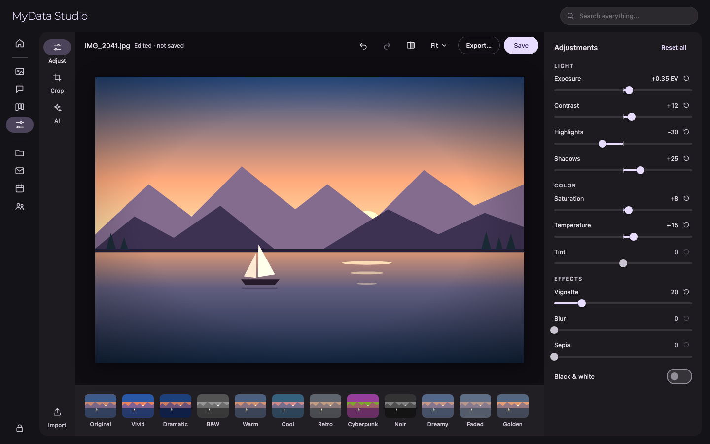
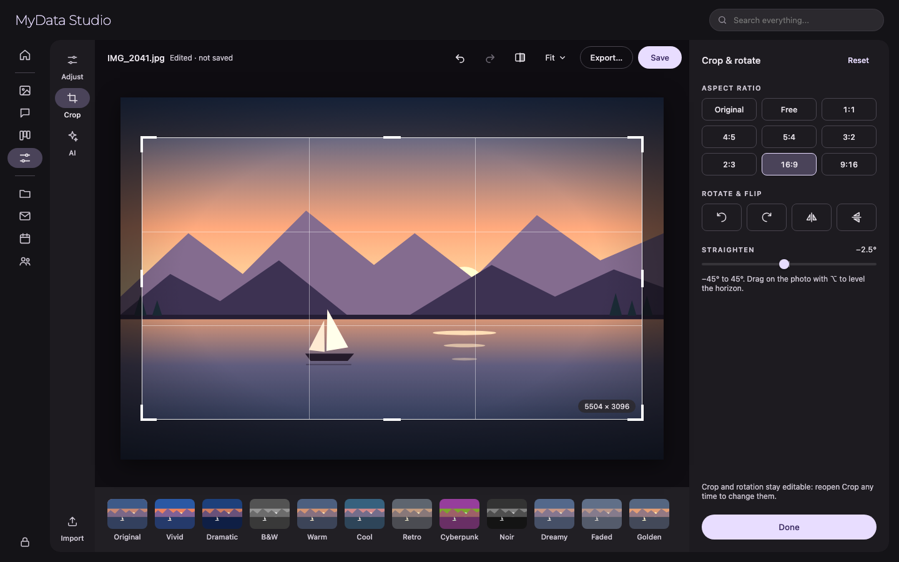
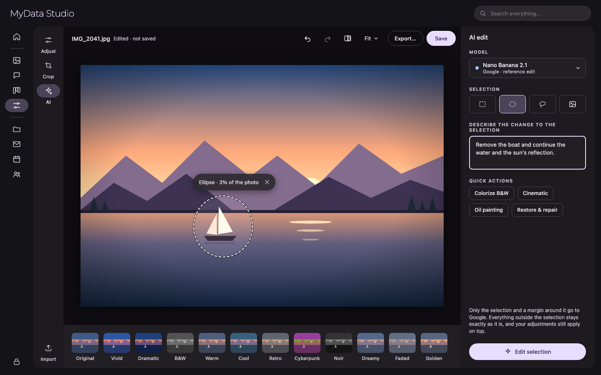
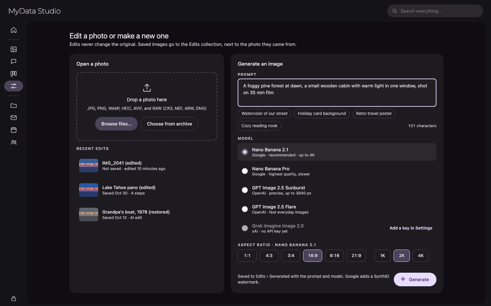

# Plan: Photo Editor app (from the `mockups/ai-photo-editor` prototype)

**Source:** `mockups/ai-photo-editor/`, a Google AI Studio React prototype ("Lightroom AI Photo
Editor": React 19, Tailwind, `motion`, `react-image-crop`, `@google/genai`). It edits one image
in the browser with CSS filters and calls Gemini directly. This plan rebuilds it as the **Photo
Editor** app module in the Flutter client (`client/lib/modules/photo_editor/`). Edits are
recorded in the SQLite archive, and all model calls go through the aiserver.

**Decisions (2026-10-26):**

| Question | Decision |
|---|---|
| Where it lives | **Both:** an **Edit** button in the photo viewer opens the current photo, and a **rail entry** (`group: 'app'`, "Editor") opens the start screen to import or generate an image. |
| Originals | **Never changed.** Edits are a **non-destructive list of steps** in the database that can be reopened and changed. **Save** writes a new image into a local **Edits** collection, linked to the original and shown next to it in Photos. |
| Generated images | Saved to the same Edits collection and a **Generated** album, with the prompt and model recorded. |
| Cloud models | The **latest** image models only: **Google Nano Banana 2.x**, **OpenAI GPT Image 2.5**, **xAI Grok Imagine Image 2.0**. Gemini 2.5 Flash Image (the prototype's model) is legacy and not offered. **Midjourney is dropped** (no public API), and so are the prototype's DALL·E 3 and FLUX entries, which only pretended to call those models. |
| Local models | **Only the image models the user adds in Settings › AI Models** appear in the editor; nothing is bundled or downloaded by default. Adding image models to that page is its own phase (E8), and the local runtime is settled there. |
| Cloud privacy prompt | **None.** Choosing a cloud model is the user's decision to send the photo to it. |
| Look and feel | **Inherit the current app theme and shell** (§4). The prototype's zinc-and-blue Tailwind palette is not ported. |

**Model ids change several times a year**, so they live in data (`aichat_models` rows, §3.3),
never in Dart or Python code. Current ids, checked 2026-10-26:

| Provider | Model | Id | Edits | Mask | Notes |
|---|---|---|---|---|---|
| Google | Nano Banana 2.1 | `gemini-nano-banana-2.1` | ✓ | — (prompt + reference) | Google's recommended model. Output 1K / 2K / 4K; up to 14 reference images. All output has a **SynthID** watermark. |
| Google | Nano Banana 2 | `gemini-3.1-flash-image` | ✓ | — | The previous generation, kept while 2.1 is new. Also offers 512 px. |
| Google | Nano Banana 2 Lite | `gemini-3.1-flash-lite-image` | ✓ | — | Fast and cheap; 1K only; weak at multi-turn edits. |
| Google | Nano Banana Pro | `gemini-3-pro-image` | ✓ | — | Highest quality, slowest. |
| OpenAI | GPT Image 2.5 Sunburst | `gpt-image-2.5-sunburst` | ✓ | ✓ (alpha PNG, same size as the image) | Best for precise edits. Sizes up to 3840 px per edge (multiples of 16); quality `low` … `max`. |
| OpenAI | GPT Image 2.5 Flare | `gpt-image-2.5-flare` | ✓ | ✓ | Fast everyday generation. |
| xAI | Grok Imagine Image 2.0 | `grok-imagine-image-2.0` | ✓ (`/v1/images/edits`) | **verify** | `aspect_ratio` (many, incl. `auto`), `resolution` `1k` / `2k`, `n` 1–10, `b64_json` or a temporary URL. $0.04 per image. |

Sources: [Gemini image generation](https://ai.google.dev/gemini-api/docs/image-generation),
[OpenAI image generation](https://developers.openai.com/api/docs/guides/image-generation),
[xAI Grok Imagine Image 2.0](https://docs.x.ai/developers/models/grok-imagine-image-2.0) and
[xAI image generation](https://docs.x.ai/developers/model-capabilities/images/generation).
**Verify at E5:** Gemini's docs now show the Interactions API (`/v1beta/interactions`, with
`response_format.aspect_ratio` / `image_size`) rather than `generateContent` + `imageConfig`;
use whichever the pinned `google-genai` SDK supports. Also verify xAI's edit request fields
(image input and mask).

Sections: [1](#1-prototype-inventory) inventories the prototype,
[2](#2-what-changes-in-the-port) says what we drop or change, [3](#3-data-model) is the schema,
[4](#4-theme-and-styling-inherited-from-the-app) the theming,
[5](#5-image-pipeline) the rendering and AI pipeline, [6](#6-flutter-architecture) the code
layout, and [7](#7-phases) the phases.

## Screens

Target designs, drawn in the app's theme and shell (§4) with sample data. The source is the
"Photo Editor screens" design canvas. They show intent; spacing and colour values come from §4.
The photo is a drawn stand-in, and presets and adjustments are approximated with CSS filters, so
the effects only roughly match the real shader (§5.1).

**Adjust** (E1, E2): the editor with no drawer, its tool rail (Adjust, Crop, AI, Import), the top
bar (Undo, Redo, Compare, zoom, Export…, Save), the preset strip, and the Light, Color and Effects
sliders. Bipolar sliders fill from the centre, exposure is in stops, and a reset icon appears on
changed values.



**Crop and straighten** (E3): a 16:9 crop with the rule-of-thirds grid, handles and output size;
the aspect ratios, rotate and flip, and the Straighten slider.



**AI edit with a selection** (E6): an ellipse selection with marching ants and a floating
Deselect bar; the model picker, selection tools, prompt and quick actions; and a note that only
the selection and a margin around it are sent.



**Start: import or generate** (E1, E7): open a photo from disk or the archive, recent edits, and
Generate with a prompt, the generate-capable models (one disabled until its provider has a key),
and the chosen model's aspect ratios and sizes. The models are shown as a list here rather than
the `MenuAnchor` picker, so a missing key is visible without opening a menu.



## 1. Prototype inventory

### 1.1 Screen layout (`App.tsx`)

| Band | Size | Contents |
|---|---|---|
| **Tool rail** (left) | 64 wide | Logo; **Adjust**, **Crop**, **AI** tabs (active one marked with a bar and tint); at the bottom **Import** and **Download**. |
| **Top bar** | 56 high | "IMAGE EDITOR" / the file name ("Untitled-1.jpg", or "No image selected"); **New** (clears the workspace; only with an image); **Undo**; **Reset** (adjustments only); **Save** (primary; it downloads the file). |
| **Canvas** | flex | The start screen (§1.2) with no image; otherwise the photo, fitted, with overlays. |
| **Preset strip** | 96 high | 12 presets as 56 px thumbnails of the original with that preset applied, with labels. Click applies one. |
| **Controls panel** (right) | 320 wide | Title per tab ("Adjustments", "Transform", "AI Generative"), a close X that does nothing, and the tab's controls. Tabs slide in and out. |

**State:** one `PhotoState` (original URL, current URL, adjustments, crop, zoom, rotation,
aspect ratio), a `history` array of earlier states, the active tab, a processing flag, the AI
prompt, and the selection state. Nothing is saved; a reload loses everything.

### 1.2 Start screen (`EmptyStateWorkspace.tsx`)

- Badge "Professional Lightroom Workspace", heading "Start Your Creative Session" and a subtitle.
- **Import a Photo** card (5/12 wide): drag and drop or click to browse; a highlight while a
  file is dragged over; format chips (RAW / JPG, PNG, WEBP, AVIF); "Browse Files". A drop that
  isn't an image is ignored silently.
- **Generate an Image** card (7/12 wide):
  - **Prompt** textarea with a character count; ⌘↩ / Ctrl↩ generates.
  - **Prompt Ideas:** four chips that fill the prompt.
  - **Aspect ratio:** 1:1 Square, 16:9 Wide, "4:5 Social" (which sends 3:4), 9:16 Story.
  - **Model picker:** a dropdown that opens upwards, with a colour dot, name, badge, description
    and provider per model, and a check on the selected one. Six models (`AVAILABLE_IMAGE_MODELS` in `types.ts`).
  - **Generate Image** (disabled without a prompt; a spinner while generating). The result opens
    in the editor with the AI tab selected.

### 1.3 Adjust tab

- **Light:** Exposure (actually drives `brightness`), Contrast, Highlights, Shadows.
- **Color:** Saturation, Temperature, Tint.
- **Effects:** Vignette (0–100), Blur (0–20), Sepia (0–100).
- Each slider shows a signed value ("+20") and a reset button that is enabled only when the
  value isn't 0. Range −100…100 unless noted.
- **Rendering** is CSS only: `brightness`, `contrast`, `saturate`, `sepia`, `grayscale`, `blur`
  and `hue-rotate` filters, an SVG `feComponentTransfer` for highlights (gamma) and shadows
  (linear), an orange or blue `soft-light` overlay for temperature, and a radial-gradient
  vignette overlay.
- **Presets** replace all adjustments: Original, Vivid, Dramatic, B&W, Warm, Cool, Retro,
  Cyberpunk, Noir, Dreamy, Faded, Golden (values in `types.ts`). `grayscale` and `exposure` exist
  only through presets.

### 1.4 Crop tab

- `react-image-crop` over the photo, with handles. Starts at the full image, or centred at the
  chosen ratio.
- **Aspect ratio:** Free, 1:1 Square, 4:5 Portrait, 16:9 Wide.
- **Rotation:** Rotate Left / Rotate Right (±90°), stored but **never drawn or applied**.
- **Apply Crop** (or a double-click on the selection or image): draws the crop to a canvas,
  replaces the current image with it, pushes history, and switches back to Adjust. A hint says
  "Double click workspace to apply crop".

### 1.5 AI tab

- A "Nano Banana Powered" note.
- **Prompt** textarea; its title and placeholder change when an area is selected.
- **Selection tools:** Rectangular Marquee, Elliptical Marquee, Lasso (each toggles selective
  mode), and Deselect (×) when there's a selection.
- **Selection overlay** (`SelectiveRegionOverlay.tsx`): drawn in percent coordinates; the
  rectangle and ellipse are dragged out from a corner; the lasso records every mouse-move point
  and keeps a bounding box. It also has a floating clear button.
- **Generate Magic / Apply Selective Edit** (disabled without a prompt):
  - whole image: sends the image and the prompt to `gemini-2.5-flash-image`;
  - selection: sends the image and a prompt that describes the region in percentages, then
    **composites** the result into the selection with a 3 px feathered mask, so pixels outside
    the selection are guaranteed unchanged.
  - On success: pushes history, **resets all adjustments**, clears the prompt and selection.
- **Quick AI Actions:** Colorize B&W, Cinematic Style, Oil Painting, Restore & Repair. Each only
  **fills the prompt**; the user still presses Generate.
- A full overlay with a spinner ("Nano Banana AI is processing...") while a request runs.

### 1.6 Prototype bugs not to copy

- **Save and Download ignore the adjustments and the rotation.** They export the last *pixel*
  result (an import, crop or AI output), so every slider change is lost.
- **Rotation is never shown or applied**, and crop ignores it.
- **Exposure drives brightness**, and `state.adjustments.exposure` is never read.
- **Tint rotates hue** up to ±100° instead of shifting green ↔ magenta.
- **Temperature is a coloured overlay**, not a white-balance change.
- **Blur is applied to the whole image**, with the preset thumbnails at half strength.
- AI results **reset the adjustments** the user had made.
- Undo has **no redo**, and History stores whole states, including data-URL images, in memory.
- "4:5 Social" sends **3:4**.
- **The model list is fake:** Grok, DALL·E 3, Midjourney and FLUX all call Gemini, with a style
  phrase prepended to the prompt. Selective edits ignore the chosen model altogether.
- **A failed generation returns a made-up gradient image** ("Rendered with …") instead of an
  error. Failed AI edits only log to the console.
- The selective prompt describes the region in **percent coordinates as text**, which models
  follow loosely; only the compositing step keeps outside pixels intact.
- Large photos are sent at **full resolution as a data URL**, and the AI result replaces the
  photo at whatever (usually smaller) size the model returns.
- The panel's close X, the top bar's Reset icon (`onClick` on the icon only) and the canvas zoom
  are not wired up.
- The API key is read from a build-time environment variable.

## 2. What changes in the port

**Dropped:** the logo, the "Professional Lightroom Workspace" badge, the fake models and the
fallback image, the "Nano Banana Powered" note, the do-nothing close X, and Midjourney.

**Changed:**
- **One render path for screen and file.** Adjustments, crop and rotation are a recipe applied
  by the same GPU shader for the preview and for the saved file (§5.1). What you see is what
  you save.
- **Adjustments are photographic:** exposure in stops, white balance for Temperature and Tint
  (green ↔ magenta), luminance-masked Highlights and Shadows, a Black & White switch (the
  prototype's hidden `grayscale`), and Vignette as a real darkening around the centre.
- **AI results keep the adjustments.** An AI step is applied to the pixels *before* the
  adjustments, so the user's sliders still apply on top. They're not reset.
- **Undo and redo** over the step list (⌘Z, ⇧⌘Z), with the steps saved to the database
  (§3.1).
- **Before / after:** hold `\` (Lightroom's key) or the compare button to see the original.
- **Zoom and pan** on the canvas (fit, 100%, scroll to zoom), reusing the viewer's
  `zoom_controller.dart`.
- **Crop gains** Original and the common portrait/landscape ratios (1:1, 4:5, 5:4, 3:2, 2:3,
  16:9, 9:16), flip horizontal/vertical, and a **Straighten** slider (−45° … 45°, new). Crop and
  rotation are part of the recipe, so they can be changed later.
- **The AI tab** has a **model picker** (edit-capable models only) instead of always using one
  model.
  - The selection is sent as a **real mask** where the model takes one (OpenAI), and as a
    **reference image of the selection** plus the prompt otherwise (Google, xAI). The result is
    always **composited** with a feathered edge, as the prototype does.
  - **Crop-and-paste for selections** (§5.3): only the selection plus a margin of context is
    sent, and the result is pasted back at full resolution, so a small edit to a 24 MP photo
    doesn't shrink the photo.
  - Quick actions still fill the prompt (unchanged), and a **Cancel** button stops a running
    request.
  - **Errors are shown** ("Google refused this edit: …", "No API key for OpenAI — add one in
    Settings › AI Models"), and nothing fake is substituted.
- **Generate** uses the same model picker (generate-capable models), and the **aspect ratios
  come from the chosen model** (each provider supports a different set). It opens the result in
  the editor and saves it to the **Generated** album.
- **Import** also offers **Choose from archive** (a photo picker over the Photos module), and
  RAW files are decoded by the aiserver (§5.1).
- **Save** writes a new file to the Edits collection (§3.2); **Export…** writes a copy anywhere
  (the prototype's Download), as JPEG, PNG or WebP. **New** asks before discarding unsaved
  steps.
- **Keyboard shortcuts** (§6), added to the app's shortcuts sheet.

## 3. Data model

Raw DDL appended to `AppDatabase.schemaDDL` (no code generation; see `CLAUDE.md`), with plain
Dart models in `models/tables/` and hand-written `fromMap`/`toMap`. Conventions match the
existing tables: `TEXT` UUID keys, `INTEGER` epoch-millisecond timestamps, and foreign keys
with explicit `ON DELETE`.

### 3.1 Tables

```sql
-- One editing session on one image: the recipe, and what it was saved as.
CREATE TABLE IF NOT EXISTS photo_edits (
  id TEXT PRIMARY KEY,
  source_file_id TEXT,                   -- the original; NULL for a generated image or once the original is deleted
  base_file_id TEXT,                     -- the pixels step 0 starts from (the original, or a generated image)
  output_file_id TEXT,                   -- the last Save; NULL until saved
  name TEXT NOT NULL,                    -- "IMG_2041 (edited)"
  step_cursor INTEGER NOT NULL DEFAULT 0,-- how many steps are applied (undo/redo position)
  is_dirty INTEGER NOT NULL DEFAULT 0,   -- steps changed since the last Save
  created_at INTEGER NOT NULL,
  updated_at INTEGER NOT NULL,
  FOREIGN KEY (source_file_id) REFERENCES files(id) ON DELETE SET NULL,
  FOREIGN KEY (base_file_id) REFERENCES files(id) ON DELETE SET NULL,
  FOREIGN KEY (output_file_id) REFERENCES files(id) ON DELETE SET NULL
);
CREATE INDEX IF NOT EXISTS idx_photo_edits_source ON photo_edits(source_file_id);
CREATE INDEX IF NOT EXISTS idx_photo_edits_output ON photo_edits(output_file_id);

-- The recipe, in order. Pixel steps (crop, ai_edit) and parameter steps (adjust) interleave.
CREATE TABLE IF NOT EXISTS photo_edit_steps (
  id TEXT PRIMARY KEY,
  edit_id TEXT NOT NULL,
  position INTEGER NOT NULL,
  kind TEXT NOT NULL CHECK (kind IN ('adjust', 'preset', 'crop', 'ai_edit')),
  params TEXT NOT NULL,                  -- JSON: adjustment values, crop rect + rotation + flip, or AI request (§3.4)
  result_path TEXT,                      -- ai_edit: the cached pixels the model returned (models aren't repeatable)
  ai_job_id TEXT,                        -- ai_edit: the request that produced result_path
  created_at INTEGER NOT NULL,
  FOREIGN KEY (edit_id) REFERENCES photo_edits(id) ON DELETE CASCADE,
  FOREIGN KEY (ai_job_id) REFERENCES ai_image_jobs(id) ON DELETE SET NULL,
  UNIQUE (edit_id, position)
);

-- Every model request, for generate and edit: provenance, cost and errors.
CREATE TABLE IF NOT EXISTS ai_image_jobs (
  id TEXT PRIMARY KEY,
  kind TEXT NOT NULL CHECK (kind IN ('generate', 'edit')),
  model_id TEXT NOT NULL,                -- aichat_models.id at the time
  provider TEXT NOT NULL,                -- 'google' | 'openai' | 'xai' | 'local'
  provider_model TEXT NOT NULL,          -- the exact id sent ("gemini-nano-banana-2.1"), kept even if the row changes
  prompt TEXT NOT NULL,
  options TEXT,                          -- JSON: aspect ratio, size, quality, seed, n
  selection TEXT,                        -- JSON: shape + points (edits with a selection)
  status TEXT NOT NULL CHECK (status IN ('running', 'succeeded', 'failed', 'cancelled')),
  error TEXT,
  output_width INTEGER,
  output_height INTEGER,
  duration_ms INTEGER,
  created_at INTEGER NOT NULL
);
CREATE INDEX IF NOT EXISTS idx_ai_image_jobs_created ON ai_image_jobs(created_at);
```

- **Undo/redo** moves `step_cursor`. Steps past the cursor are kept until a new step is added,
  which deletes them (the usual redo rule). Consecutive slider changes to the same adjustment
  **merge into one step** after 500 ms of no change, so a drag is one undo, not a hundred.
- **`result_path`** files live under `<appData>/Edits/.cache/` and are deleted with their step.
  They're not `files` rows, so they don't show up in Photos.
- **A generated image** is saved straight away as a file in the Edits collection, and opening it
  creates a `photo_edits` row with `base_file_id` = that file and no `source_file_id`.

### 3.2 The Edits collection

- A normal **local collection** (`type 'file'`, scanner `file.local`), created on first use,
  named **"Edits"**, pointing at `<appData>/Edits/`. The local scanner then indexes, thumbnails,
  describes and embeds saved images like any other file, with nothing editor-specific.
- **Save** writes `<appData>/Edits/YYYY/MM/<name>.jpg` and upserts its `files` row straight
  away (through the main-isolate write path), rather than waiting for the next scan.
- **Generated** images go to `<appData>/Edits/Generated/…` and are added to a **Generated**
  album (`albums` / `album_files`, created on first use).
- **The link to the original** is `photo_edits.source_file_id` → `output_file_id`:
  - the viewer shows **Edited versions (n)** on an original and **Show original** on an edit;
  - the gallery shows a small "edited" badge on saved edits;
  - deleting the original leaves the edit (with `source_file_id` NULL), and deleting the edit's
    output keeps its recipe, so it can be saved again.
- **Saving again** after more changes **overwrites the same output file** (same `files` row, new
  `date_last_modified`). **Save as copy** creates a new `photo_edits` row from the current
  recipe.
- **Metadata:** the saved file keeps the original's EXIF (date taken, camera, GPS), with the
  orientation reset and the dimensions updated, and adds `Software` = "My Data Studio". **AI
  output** also gets IPTC `DigitalSourceType` = `trainedAlgorithmicMedia` (generated) or
  `compositeWithTrainedAlgorithmicMedia` (edited), and the provider's C2PA manifest is kept
  when there is one.

### 3.3 Image models in the model registry

Image models are **rows in the existing `aichat_models` table**, next to the chat models, so
they're managed on the same Settings page and use the same API keys (`providers` table, one key
per cloud group, already entered for chat). Two columns are added with `_addMissingColumns()`:

```text
aichat_models.capabilities  TEXT NOT NULL DEFAULT 'chat'   -- comma list: chat, image_generate, image_edit, image_mask
aichat_models.image_options TEXT                           -- JSON: aspect ratios, sizes, quality levels, max input px, reference-image limit
```

- **Seed rows** (via `_loadInitialData`, upsert by alias, like the rail entries): the cloud
  models in the table at the top, **disabled until their provider has a key**. A new model is a
  new seed row or a row the user adds; retiring one is a row change, not a code change.
- The editor's pickers list **enabled** rows with `image_edit` (AI tab) or `image_generate`
  (Generate). Chat model pickers keep filtering on `chat`, so image models never show up in AI
  Chat.
- Local image models (E8) are rows with `type = 'local'` and the image capabilities.

### 3.4 Step parameters

```text
adjust   {"exposure": 0.0, "contrast": 0, "highlights": 0, "shadows": 0,
          "saturation": 0, "temperature": 0, "tint": 0, "vignette": 0,
          "blur": 0, "sepia": 0, "black_and_white": false}       -- the full set, so a step is self-contained
preset   {"name": "Noir", "values": {…same keys…}}                -- applied values are stored, so editing presets later changes nothing
crop     {"rect": [x, y, w, h] in 0–1 of the incoming image, "rotate_quarter": 0–3,
          "straighten_deg": 0.0, "flip_h": false, "flip_v": false, "aspect": "4:5" | null}
ai_edit  {"job_id": "…", "prompt": "…", "model": "…", "selection": {shape, points} | null,
          "applied_to": [x, y, w, h], "feather_px": 3}
```

- **How a recipe renders:** walk the steps up to the cursor. Every `crop` and `ai_edit` produces
  new pixels from the pixels before it; the **latest `adjust` or `preset` values** are applied
  once, at the end, on top of the last pixels. So adjustments always stay live and editable,
  even after an AI edit (the prototype reset them).
- `adjust.exposure` is in stops (−4 … +4); the rest are −100 … 100 or 0 … 100, as the
  prototype's ranges.

## 4. Theme and styling: inherited from the app

The editor adds **no colours, fonts or shapes of its own.** Everything comes from `_buildTheme`
in `family_dam_app.dart`, `color_schemes.g.dart`, `DESIGN.md` and the shell's widgets, as in the
Tasks and Calendar plans.

| App today | Editor uses it for |
|---|---|
| **Dark only:** the dark `ColorScheme` (obsidian surfaces, lavender `primary`) | Every colour via `Theme.of(context).colorScheme`; no hex values in `modules/photo_editor/`. The prototype's blue accents become `primary`. |
| **System font** with the `_buildTheme` sizes | `labelSmall` micro-caps for group titles ("LIGHT", "COLOR") and slider labels, as `DESIGN.md` describes; `bodySmall` values with tabular figures; `titleSmall` panel titles. |
| **Surface scale** | Canvas background `surfaceContainerLowest` (photos are judged against a dark neutral); tool rail and panel `surfaceContainerLow`; the preset strip `surfaceContainer`; inputs `surfaceContainerHigh`. |
| **"The No-Line Rule"** | No divider lines. The prototype's `border-b` group headers and panel borders become spacing and tonal steps. |
| **Shell:** `RoutePage` + `NavigationWrapper(body:, drawer:)` | `/editor` uses `NavigationWrapper` **without a drawer** (the editor needs the width); the editor's own tool rail sits inside the body. |
| **`DESIGN.md` components:** icon-only buttons with a circular hover; panel radius 16; primary buttons | Tool rail tabs (`NavigationRail`-style selected indicator in `secondaryContainer`); top-bar icons (Undo, Redo, Compare); **Save** is a `FilledButton`; quick actions are `OutlinedButton`s; the model picker is a `MenuAnchor`. |
| **Sliders:** the M3 `SliderTheme` | **Bipolar sliders** (−100 … 100) fill from the centre with a custom `SliderTrackShape`, in `primary`. **Double-clicking a slider resets it** (Lightroom's gesture), alongside the prototype's reset icon. Values in `onSurfaceVariant`, `onSurface` when changed. |
| **Dialogs:** `Dialog` / `AlertDialog` | "Discard unsaved edits?", Export options, and errors. |
| **Glass** ([glassmorphism-elevation.md](glassmorphism-elevation.md)) | The progress overlay on the canvas and the floating selection toolbar, if the glass widgets exist by then; otherwise `surfaceContainerHigh` at 85% opacity. |

**Canvas overlays** (crop handles, the rule-of-thirds grid, selection outlines) are drawn in
`onSurface` with a dark outline, so they read on any photo; the selection uses marching ants (a
moving dashed outline), as in Photoshop.

**Motion:** 150–200 ms, `Curves.easeOutCubic`, as in the other app plans. Panels cross-fade.

## 5. Image pipeline

### 5.1 Rendering

- **One fragment shader** (`shaders/photo_adjust.frag`, Flutter's `FragmentProgram`; Impeller
  on macOS) applies the adjustments in this order: exposure → white balance (temperature, tint)
  → highlights/shadows → contrast → saturation → black & white → sepia → vignette. It works in
  linear light (sRGB decode, adjust, encode). Blur is a separate `ImageFilter.blur` pass before
  the shader.
- **The same maths in Dart** (`adjust_reference.dart`) runs on single pixels in unit tests, and a
  golden test compares the shader's output to it on a test image. The shader and the reference
  can't drift apart unnoticed.
- **Preview** renders a screen-sized version of the current pixels through the shader on every
  slider change (target: 60 fps on a 4K-wide preview on Apple Silicon).
- **Save / Export** renders the **full-resolution** pixels through the same shader into an
  offscreen image (`PictureRecorder` → `toImage`), in tiles if the photo exceeds the GPU's
  texture limit (**verify** the limit on Impeller/macOS; 16384 px is typical).
- **Encoding and metadata** go through a new aiserver endpoint, `POST /util/image/finalize`
  (Pillow): it encodes JPEG (quality 92), PNG or WebP, and copies and updates EXIF, IPTC and XMP
  (§3.2). The `image` Dart package was the alternative, but it's slow on 24 MP and has no
  metadata writing.
- **RAW** files are decoded by a new `POST /util/image/decode` (`rawpy`, already a dependency),
  which returns an 8-bit sRGB PNG at full size. A 16-bit RAW pipeline is later (E9).
- **Preset thumbnails** are the same shader on a 112 px copy of the current pixels.

### 5.2 Model calls: one aiserver API for every provider

New aiserver routes, with bearer-token auth like the rest:

| Route | Body | Returns |
|---|---|---|
| `POST /v1/images/generate` | `model` (alias), `prompt`, `options` (aspect, size, quality, n, seed), `api_key` | `{images: [{b64, width, height, mime}], provider_model, c2pa?}` |
| `POST /v1/images/edit` | as above, plus `image` (b64), optional `mask` (b64, white = edit), optional `references` | the same |
| `POST /v1/images/stop` | `request_id` | cancels a running request (like `/v1/chat/stop`) |

- `model_registry.py` resolves the alias to a provider and model id from `aichat_models`, the
  same way chat models are resolved. The **API key is sent per request as `api_key`**, as
  `LocalLlmContentGenerator` does for chat.
- **Adapters** in `image_models.py`, one per provider, behind one interface
  (`generate(prompt, options)`, `edit(image, prompt, mask, options)`):
  - **Google:** the `google-genai` SDK. Edits send the image and prompt, and for a selection a
    second reference image showing the selected area, with the instruction "change only the
    highlighted area". Aspect and size map to `aspect_ratio` / `image_size` ("1K", "2K", "4K").
  - **OpenAI:** `images.generate` / `images.edit` with `model`, `size`, `quality`, and the mask as
    an alpha PNG of the same size as the image. Returns `b64_json`.
  - **xAI:** `/v1/images/generations` and `/v1/images/edits` with `response_format=b64_json`
    (temporary URLs expire). Mask support is checked at E5; without it, xAI is handled like
    Google.
  - **Local** (E8): the runtime chosen in E8.
- **Errors** come back as typed codes (`no_api_key`, `refused`, `rate_limited`, `too_large`,
  `provider_error`) with the provider's message, so the client can explain them. **There's no
  fallback image.**
- **Images are never stored by the aiserver.** It returns the bytes, and the client writes them
  to `result_path` (edits) or the Edits collection (generations).

### 5.3 AI edits with a selection

1. **Rasterise the selection** (rectangle, ellipse or lasso polygon) into a mask at the current
   image's full resolution.
2. **Crop to the selection's bounding box plus 25% context** on each side (clamped to the
   image), so the model sees the surroundings.
3. **Fit the crop to the model's limits** (`image_options.max_input_px`, and OpenAI's
   multiple-of-16 sizes), scaling down if needed.
4. **Call** `/v1/images/edit` with the crop, the prompt, and the cropped mask (as an alpha mask
   for OpenAI, or as a reference image otherwise).
5. **Scale the result back** to the crop's full-resolution size, and **composite** it into the
   image through the mask, feathered 3 px (the prototype's approach). Pixels outside the
   selection are bit-for-bit unchanged; a test checks this.
6. **Whole-image edits** (no selection) send the whole image scaled to the model's limit. The
   result replaces the pixels at the model's output size, and the editor says so ("AI result is
   2048 × 1365; the original was 6000 × 4000").

## 6. Flutter architecture

```text
client/lib/modules/photo_editor/
  pages/
    photo_editor_page.dart         # /editor, /editor/file/:fileId, /editor/edit/:editId
  widgets/
    start_screen.dart              # import card (drop, browse, choose from archive) + generate card
    generate_card.dart             # prompt, ideas, aspect (from the model), model picker, Generate
    editor_tool_rail.dart          # Adjust, Crop, AI; Import, Export
    editor_top_bar.dart            # name, New, Undo, Redo, Compare, Save (+ Save as copy, Export…)
    editor_canvas.dart             # zoom/pan, shader preview, overlays, progress overlay
    preset_strip.dart
    adjust_panel.dart              # groups + AdjustmentSlider
    adjustment_slider.dart         # bipolar track, signed value, reset, double-click reset
    crop_panel.dart, crop_overlay.dart
    ai_panel.dart                  # model picker, prompt, selection tools, quick actions, Apply/Cancel
    selection_overlay.dart         # rect, ellipse, lasso; marching ants
    model_picker.dart              # MenuAnchor over aichat_models filtered by capability
  services/
    photo_editor_controller.dart   # the open edit: steps, cursor, current pixels, dirty state
    recipe_renderer.dart           # steps -> pixels (crop/AI) + final adjustments; preview and full-res
    adjust_reference.dart          # pure: the shader's maths for tests
    crop_geometry.dart             # pure: aspect fitting, rotation, straighten, flip
    selection_mask.dart            # pure: shape -> mask; bounding box + context crop
    image_model_client.dart        # /v1/images/* calls, typed errors, cancel
    presets.dart                   # the 12 built-in presets (values from the prototype, re-tuned)
  shaders/photo_adjust.frag
client/lib/repositories/photo_edit_repository.dart
client/lib/models/tables/photo_edit.dart, photo_edit_step.dart, ai_image_job.dart
aiserver/src/aichat/image_models.py    # provider adapters (§5.2)
aiserver/src/aichat/routes.py          # + /v1/images/*, /util/image/decode, /util/image/finalize
```

- **Route and rail:** a seed row in `_loadInitialData`: `slug: 'editor'`, `name: 'Editor'`,
  `group: 'app'`, the `Icons.auto_fix_high` code point, `route: '/editor'`. The photo viewer
  (`fullscreen_viewer.dart`) gets an **Edit** button that opens `/editor/file/<id>`, or the
  existing edit for that file if there's an unsaved one.
- **State:** `PhotoEditorController`, using the same state pattern as Tasks and Calendar
  (whichever the photos rewrite settled on). Every step change writes to the database straight
  away, so closing the app mid-edit loses nothing; reopening the photo offers "Continue
  editing".
- **Pixels in memory:** the controller keeps the current `ui.Image` (the result of the last
  pixel step) and a preview-sized copy, not one image per history entry. Undoing past a pixel
  step re-renders from the nearest earlier cached result.
- **Shortcuts:** ⌘Z / ⇧⌘Z undo/redo; `\` hold for before/after; `R` crop, `A` adjust, `I` AI
  (tabs); `M` rectangle, `E` ellipse, `L` lasso; ⌘D deselect; `Enter` applies a crop, `Esc`
  cancels it or clears the selection; ⌘S save, ⇧⌘S save as copy, ⇧⌘E export; ⌘0 fit, ⌘1 100%;
  ⌘↩ generates or applies the AI prompt.
- **Drag and drop:** dropping image files on the start screen or the canvas opens the first one
  (asking first if there are unsaved steps). The app has no drop package yet (only
  `file_picker`), so this adds `desktop_drop` (**verify** it's maintained and supports macOS,
  Windows and Linux). Non-image files get a snackbar instead of being
  silently ignored.

## 7. Phases

Each phase ends with a working, tested slice. Tests come first for the repository and the pure
services. Widget tests cover each phase's UI. `flutter analyze` must be clean and the full
`flutter test` suite must pass; aiserver changes also pass `pdm run pytest`.

### E0. Schema and the Edits collection

- [ ] The DDL from §3.1, and the two `aichat_models` columns via `_addMissingColumns()`.
- [ ] Models `PhotoEdit`, `PhotoEditStep`, `AiImageJob`; `fromMap` / `toMap`; the step params
      as typed classes with JSON.
- [ ] `PhotoEditRepository`: create, add a step (deleting steps past the cursor), move the
      cursor, merge slider steps, mark saved, link outputs, find edits by source file.
- [ ] `ensureEditsCollection()` and `ensureGeneratedAlbum()`.
- [ ] Tests: round trips; adding a step after an undo deletes the redo steps; merging; deleting
      an original sets `source_file_id` NULL and keeps the edit; deleting an edit cascades its
      steps and removes their cache files; existing `aichat_models` rows default to `chat`.

**Done when** the tests pass and `database_manager_test` still passes on an existing archive.

### E1. Editor shell

- [ ] The rail seed row, routes, and the viewer's **Edit** button.
- [ ] The start screen's **Import** card: drop, browse, **Choose from archive**; RAW via
      `/util/image/decode`.
- [ ] The editor layout: tool rail, top bar, canvas with zoom/pan and before/after, the empty
      controls panel, and the preset strip (inert).
- [ ] New, with "Discard unsaved edits?".
- [ ] Widget tests: opening from the viewer shows that photo; a drop of a non-image shows the
      snackbar; New asks only when there are unsaved steps.

**Done when** any archived photo, including RAW, opens in the editor from the viewer or the
rail.

### E2. Adjustments and presets

- [ ] `photo_adjust.frag` and `adjust_reference.dart` (§5.1), and the golden comparison test.
- [ ] The Adjust panel: Light (Exposure, Contrast, Highlights, Shadows), Color (Temperature,
      Tint, Saturation, Black & White), Effects (Vignette, Blur, Sepia); bipolar sliders,
      signed values, reset icon and double-click reset.
- [ ] The preset strip with live thumbnails; a preset is one step; Reset sets every value to 0
      as one step.
- [ ] Undo/redo with slider-step merging.
- [ ] Tests: each adjustment's reference maths (exposure +1 doubles linear values; temperature
      warms without changing luminance much; tint moves green ↔ magenta; B&W gives R = G = B);
      a slider drag is one undo step; presets replace all values; the golden test.

**Done when** adjusting a photo looks right and every change can be undone and redone.

### E3. Crop and transform

- [ ] `crop_overlay.dart`: handles, move, rule-of-thirds grid while dragging, aspect lock.
- [ ] The Crop panel: Free, Original, 1:1, 4:5, 5:4, 3:2, 2:3, 16:9, 9:16; rotate left/right;
      flip H/V; Straighten.
- [ ] Apply (button, `Enter`, or double-click inside the crop) and Cancel (`Esc`). A crop is one
      step and can be re-opened and changed later.
- [ ] Tests (`crop_geometry.dart`): aspect fitting centred in the image; rotate four times
      returns to the start; straighten keeps the crop inside the rotated image; flips; the
      rendered crop has the expected pixel size.

**Done when** crop, rotate, flip and straighten all apply to the preview and are part of the
recipe.

### E4. Save, export and reopen

- [ ] Full-resolution rendering (tiled if needed) and `/util/image/finalize` (encode + EXIF /
      IPTC / XMP, §3.2).
- [ ] **Save** to the Edits collection (upserting the `files` row), **Save as copy**, and
      **Export…** (format, quality, where).
- [ ] Viewer and gallery: **Edited versions (n)**, **Show original**, the edited badge.
- [ ] Reopening a saved edit restores its steps and cursor; "Continue editing" for unsaved ones.
- [ ] Tests: a saved file's pixels match the preview (scaled); EXIF date, camera and GPS
      survive and orientation is reset; saving twice overwrites the same file row; Save as copy
      makes a second edit; the Edits collection indexes the file (thumbnail, search) without a
      rescan.

**Done when** an edit is saved next to the original in Photos, and reopening it brings back
every step.

### E5. Image model service (aiserver)

- [ ] `/v1/images/generate`, `/v1/images/edit`, `/v1/images/stop`, with the Google, OpenAI and
      xAI adapters (§5.2) and typed errors.
- [ ] Verify the open items in the model table (Gemini's API shape for the pinned SDK; xAI's
      edit fields and mask support) and record them here.
- [ ] Seed rows for the cloud image models with `capabilities` and `image_options`, enabled
      once their provider has a key.
- [ ] **Settings › AI Models:** an **Image models** section listing them, sharing the existing
      cloud key fields.
- [ ] Tests (pytest, recorded responses, no live calls): each adapter's request shape; mask
      encoding for OpenAI; `b64` decoding; each error code; stop cancels a running request; a
      missing key gives `no_api_key`.

**Done when** each cloud provider can generate and edit an image through the aiserver, with
clear errors.

### E6. AI edits in the editor

- [ ] The AI panel: the model picker (`image_edit` models), prompt, quick actions (fill the
      prompt, as in the prototype), Apply and Cancel, the progress overlay, and error messages
      with a link to Settings for key problems.
- [ ] `selection_overlay.dart`: rectangle, ellipse and lasso (simplified to about 1 px
      tolerance), marching ants, Deselect, and moving a finished selection by dragging it.
- [ ] `selection_mask.dart` and the crop-and-paste flow (§5.3); whole-image edits with the size
      notice.
- [ ] An `ai_edit` step stores its `result_path` and `ai_image_jobs` row; adjustments stay on
      top of the result.
- [ ] Tests: pixels outside the selection are unchanged after compositing; the context crop is
      clamped at image edges; a lasso with fewer than three points is ignored; a cancelled job
      adds no step; an error adds no step and shows the message; undoing an AI step restores
      the earlier pixels without a new request.

**Done when** a selected area of a photo can be changed with any configured cloud model, at full
resolution, with everything outside the selection untouched.

### E7. Generate an image

- [ ] The start screen's **Generate** card: prompt with count and ⌘↩, prompt ideas, the model
      picker (`image_generate` models), aspect ratios and sizes from the model's
      `image_options`, Generate and Cancel.
- [ ] The result is saved to the Edits collection and the Generated album, with the job's
      provenance and IPTC/XMP tags, then opens in the editor on the AI tab.
- [ ] Tests: the aspect list changes with the model; a failure shows the error (no fake image);
      the saved file has the provenance tags and appears in the Generated album.

**Done when** an image can be generated with each cloud model and is kept in the archive with its
prompt.

### E8. Local image models

The user adds local image models in **Settings › AI Models**; the editor lists whatever is
there. Nothing is bundled or downloaded by default.

- [ ] **Settings:** an **Add local image model** flow in the Image models section: a Hugging
      Face repo (and file, for GGUF), the capabilities it has (generate, edit, mask), and
      download progress via the existing `/util/download-model` SSE.
- [ ] **Runtime spike first**, recorded here. The candidates:
  - **stable-diffusion.cpp** (GGUF, Metal, a Python binding), the same pattern as the chat
    models' llama.cpp. It runs FLUX, SDXL, SD 3.5 and Qwen-Image, and has edit models (FLUX
    Kontext, FLUX Fill, Qwen-Image-Edit).
  - **`diffusers` on `torch`**, already a dependency, which covers more models but is heavier.

  Measure memory and time per image on an M-series Mac for one generate model and one edit
  model on each.
- [ ] A **local adapter** in `image_models.py`. Generation holds the shared model slot like chat
      (`state.generation_lock`), so a running image job and a chat reply don't load two models
      at once.
- [ ] Tests: a registered local model appears in the right picker by capability; a model without
      `image_edit` is not offered for edits; a local job reports progress and can be stopped.

**Done when** a local image model added in Settings can generate (and, if it's an edit model,
edit) from the editor, with no network access.

### E9. Later (not scheduled)

- **Better selections:** a brush with soft edges, and **select subject** with a local
  segmentation model.
- **Your own presets:** Save as preset, and copy/paste settings between photos.
- **Batch:** apply a preset or recipe to many photos from the gallery.
- **History panel** listing the steps, with jumping to any one.
- **More tools:** tone curve, HSL, sharpening, noise reduction.
- **16-bit RAW pipeline** (half-float textures from `rawpy`).
- **Variations:** `n` > 1 for generate, with a picker.
- **LLM tools:** "brighten this photo" or "remove the people in the background" from AI Chat,
  through the tool registry ([ADR 0001](../adr/0001-llm-tool-registry.md)).

## Open questions

None at the moment. All the questions so far are settled in the decisions table at the top.
